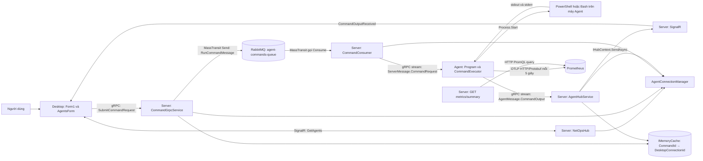
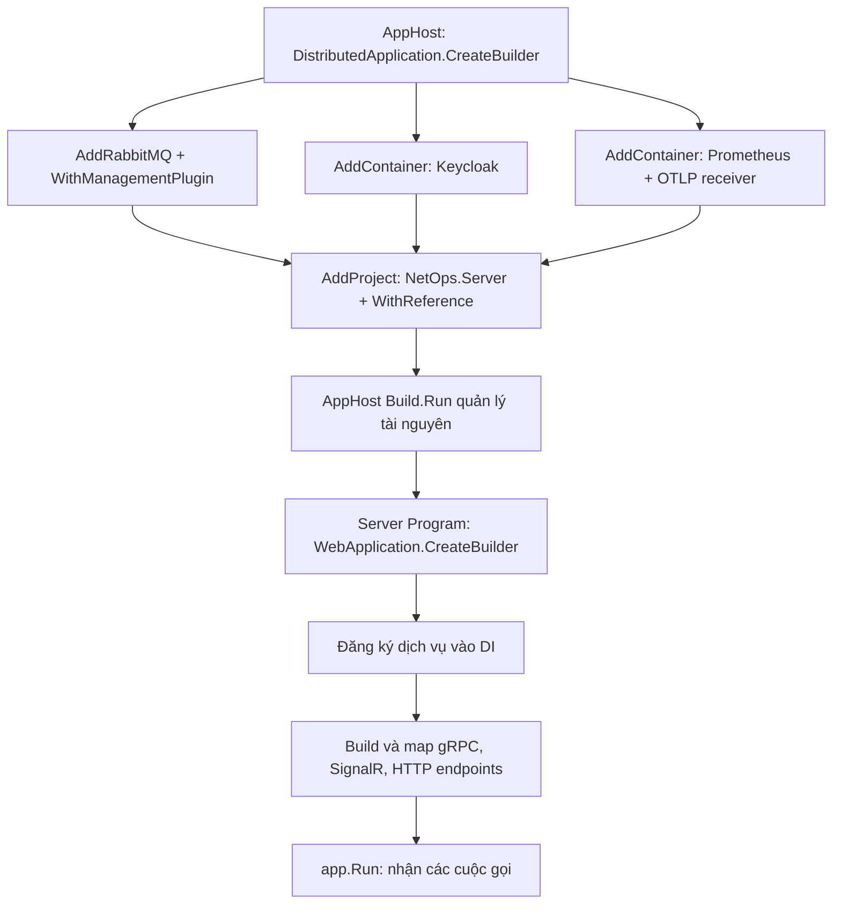
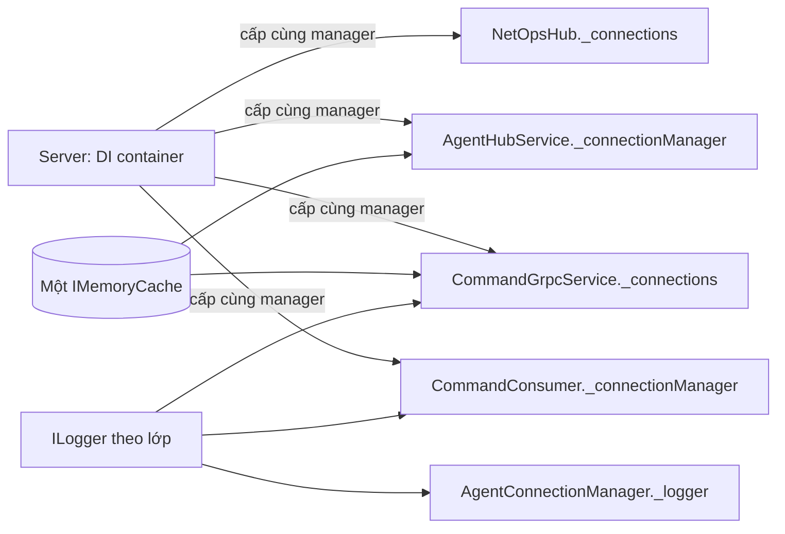
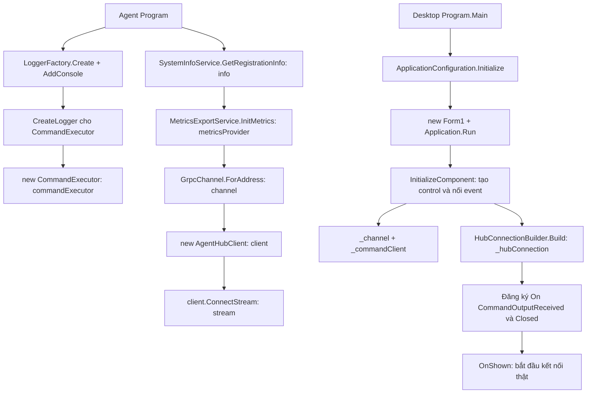
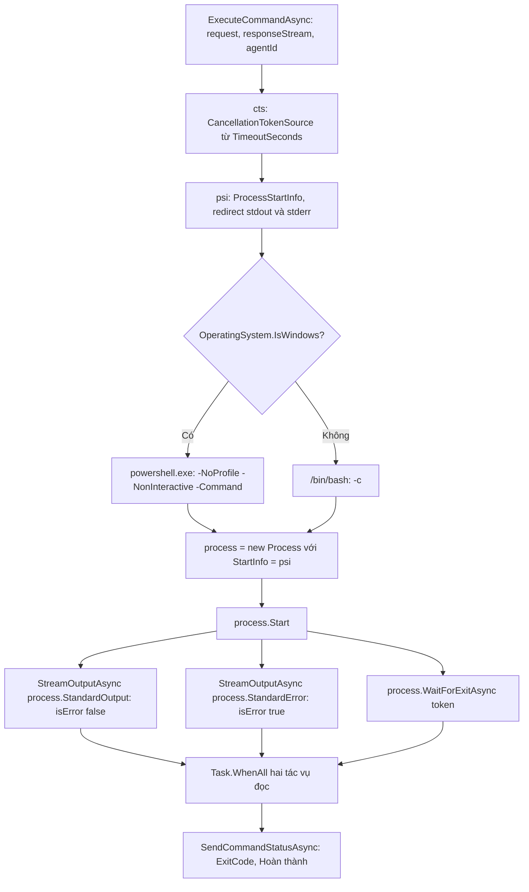
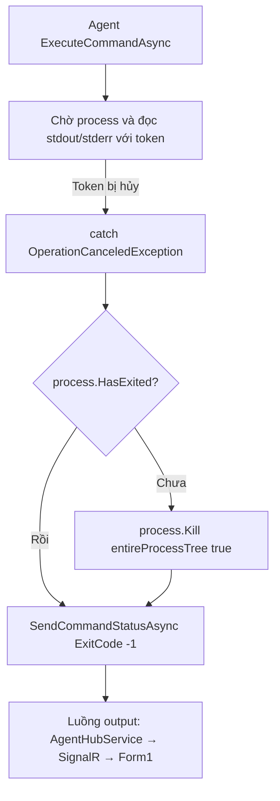
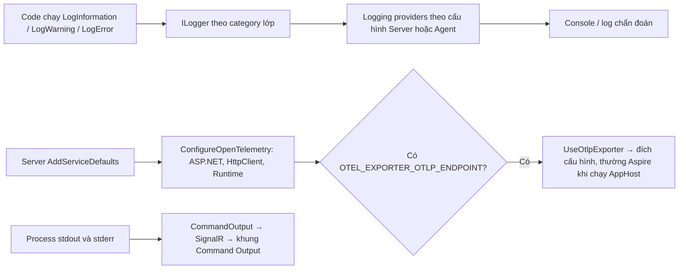
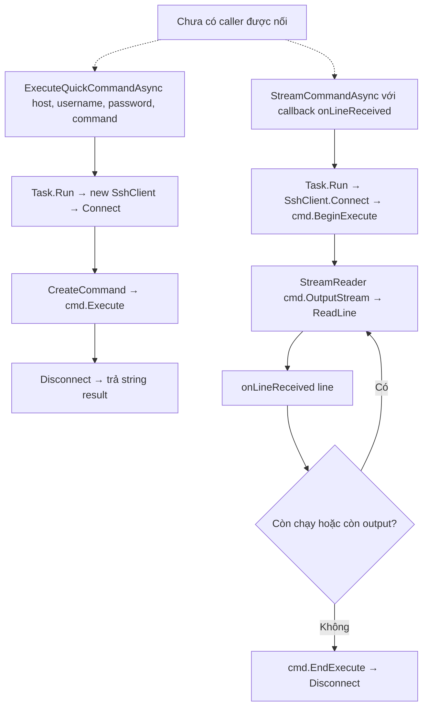
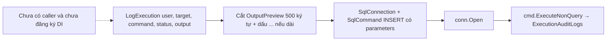
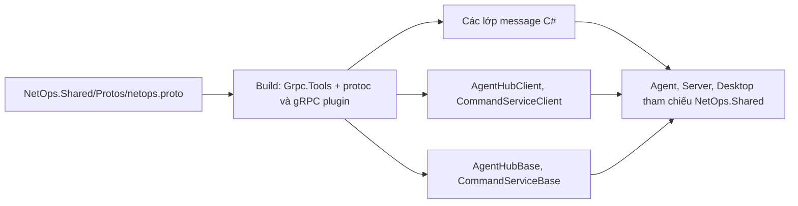

# Bản đồ luồng NetOps — code hiện tại

Đối chiếu trực tiếp mã nguồn ngày **08/11/2026**, gồm cả thay đổi chưa commit. Đây là bản đồ hành vi được đọc từ code, không phải xác nhận mọi nhánh đã được chạy thử. Khi code thay đổi, cập nhật sơ đồ cùng thay đổi đó.

Phạm vi: toàn bộ luồng nghiệp vụ, khởi động, trạng thái và các hàm ứng dụng trong `src`; các lời gọi nội bộ của .NET, gRPC, SignalR và RabbitMQ được gom tại ranh giới thư viện.

## Cách đọc

- Mũi tên: lời gọi hàm hoặc truyền dữ liệu; nhãn chỉ rõ loại nào.
- Trong sequence diagram, thời gian đi từ trên xuống. Hai nhánh `par` có thể chạy đồng thời; không có một thứ tự tuyệt đối giữa các tiến trình.
- “Server” gồm nhiều lớp nhưng chạy trong cùng ứng dụng `NetOps.Server`. `CommandConsumer` không phải chương trình chạy trên Agent.
- “Shared” chứa định nghĩa kiểu dữ liệu và mã được sinh từ proto; không phải máy chủ hay trạm trung chuyển.
- Tên trước dấu chấm là lớp/đối tượng; tên có `(...)` là hàm. Ví dụ `_commandClient` là đối tượng, còn `_commandClient.SubmitCommandAsync(...)` mới là hành động.

## Mục lục

| Luồng | Xem khi bạn muốn hiểu |
|---|---|
| [0. Tổng quan](#0-tổng-quan) | Những chương trình nào nối với nhau |
| [1. Khởi động và tạo đối tượng](#1-khởi-động-và-tạo-đối-tượng) | Constructor, DI, logger đến từ đâu |
| [2. Agent đăng ký](#2-agent-đăng-ký) | AgentId, thông tin máy và stream được lưu thế nào |
| [3. Heartbeat](#3-heartbeat) | Nhịp tim cập nhật cái gì |
| [4. Desktop kết nối và tải danh sách](#4-desktop-kết-nối-và-tải-danh-sách) | SignalR, GetAgents, AgentSummary |
| [5. Browse, tìm kiếm, chọn Agent](#5-browse-tìm-kiếm-chọn-agent) | Form1 và AgentsForm gọi nhau thế nào |
| [6. Gửi lệnh tới Agent](#6-gửi-lệnh-tới-agent) | gRPC → queue → consumer → Agent |
| [7. Chạy lệnh và trả output](#7-chạy-lệnh-và-trả-output) | Process → gRPC → SignalR → khung output |
| [8. Lỗi và timeout](#8-lỗi-và-timeout) | Lệnh có thể dừng hoặc thất bại ở đâu |
| [9. Ngắt kết nối và đóng cửa sổ](#9-ngắt-kết-nối-và-đóng-cửa-sổ) | Ai xóa kết nối, ai hủy tác vụ |
| [10. Metrics](#10-metrics) | OpenTelemetry → Prometheus → HTTP API |
| [11. Logging, chẩn đoán và endpoint phụ](#11-logging-chẩn-đoán-và-endpoint-phụ) | Log khác output thế nào |
| [12. Phần chưa nối vào luồng](#12-phần-chưa-nối-vào-luồng) | SSH, audit, WatchCommand, Keycloak |
| [13. Danh bạ đối tượng và dữ liệu](#13-danh-bạ-đối-tượng-và-dữ-liệu) | Biến nào giữ gì, ở máy nào |
| [14. Danh mục hàm](#14-danh-mục-hàm) | Tra tên hàm đã quên |
| [15. Cách dùng bản đồ để học](#15-cách-dùng-bản-đồ-để-học) | Đi từng luồng trong debugger |
| [16. Tài liệu chính thức](#16-tài-liệu-chính-thức) | Phần nào tự viết, phần nào do thư viện cung cấp |

## 0. Tổng quan



**Đường gửi lệnh và đường trả output khác nhau.** `SubmitCommandResponse` trả `CommandId` sau bước gửi queue; output về bằng SignalR. Agent không kết nối RabbitMQ. Output không đi ngược qua RabbitMQ.

Địa chỉ hiện được viết trong code:

| Nơi | Địa chỉ/cấu hình |
|---|---|
| Agent và Desktop gọi Server | `https://localhost:7027` |
| Desktop kết nối SignalR | `https://localhost:7027/hubs/netops` |
| Agent gửi metrics | `http://localhost:9090/api/v1/otlp/v1/metrics` |
| Server truy vấn Prometheus | `http://localhost:9090/api/v1/query` |
| Keycloak | Cổng HTTP `8080`, container `start-dev` |
| RabbitMQ | Connection string tên `rabbitmq` từ cấu hình/Aspire; fallback `rabbitmq://localhost`. Cổng host do Aspire cấp, không cố định trong code này. |

`localhost` là máy đang chạy tiến trình gọi. Nếu chuyển Agent sang máy khác, các địa chỉ hiện tại cần được cấu hình lại.

## 1. Khởi động và tạo đối tượng

### 1.1 AppHost và Server

Điểm vào: [AppHost.cs](../src/NetOps.AppHost/AppHost.cs), [Server/Program.cs](../src/NetOps.Server/Program.cs), [MassTransitExtensions.cs](../src/NetOps.Server/Extensions/MassTransitExtensions.cs).



AppHost hiện tự khởi chạy **Server, RabbitMQ, Keycloak, Prometheus**. Desktop và Agent được mở riêng. Server đang được thêm bằng `AddProject`, không phải container Server trong cấu hình này. Các reference cung cấp thông tin kết nối; chúng không làm AppHost trở thành nơi chuyển từng lệnh.

| Đăng ký trong Server | Đối tượng/chức năng được framework cung cấp |
|---|---|
| `AddServiceDefaults()` | Logging/OTel, health check, service discovery, cấu hình HttpClient chung |
| `AddGrpc()` | Hạ tầng nhận lời gọi gRPC |
| `AddMemoryCache()` | `IMemoryCache` dùng chung trong Server |
| `AddSingleton<AgentConnectionManager>()` | Một manager dùng chung trong một lần chạy Server |
| `AddRabbitMqMassTransit(configuration)` | Hạ tầng MassTransit, `ISendEndpointProvider`, consumer và kết nối broker |
| `AddSingleton<SshCommandService>()` | Cho phép DI cấp dịch vụ SSH; hiện chưa có người gọi từ UI/API |
| `AddHttpClient("Prometheus", ...)` | `IHttpClientFactory` tạo client có base address Prometheus |
| `AddSignalR()` | Hạ tầng Hub và `IHubContext<NetOpsHub>` |
| `AddOpenApi()` | Dịch vụ mô tả API; `MapOpenApi()` được bật trong Development |

Sau đó `MapGrpcService<AgentHubService>()`, `MapGrpcService<CommandGrpcService>()` và `MapHub<NetOpsHub>("/hubs/netops")` gắn lớp xử lý với hạ tầng nhận mạng. Đăng ký dịch vụ và map endpoint là hai việc khác nhau.



Framework tạo đối tượng lớp xử lý khi cần và truyền dependency qua constructor. Ví dụ constructor `AgentConnectionManager(ILogger<AgentConnectionManager> logger)` nhận logger do DI cấp; `_logger = logger` lưu tham chiếu để các hàm khác dùng. Phép gán đó không tạo log. Log phát sinh khi chạy `_logger.LogInformation(...)`, `LogWarning(...)` hoặc `LogError(...)` và mức log đó được cho phép.

### 1.2 Agent và Desktop



Agent hiện tự `new CommandExecutor`, không dùng DI như Server. Desktop cũng tự tạo client trong constructor. `GrpcChannel.ForAddress` chuẩn bị kênh, tạo client chuẩn bị công cụ gọi API; không đồng nghĩa lệnh đã được gửi. `HubConnectionBuilder.Build()` chuẩn bị kết nối SignalR; `StartAsync()` mới bắt đầu kết nối.

## 2. Agent đăng ký

Điểm vào: [Agent/Program.cs](../src/NetOps.Agent/Program.cs), [SystemInfoService.cs](../src/NetOps.Agent/SystemInfoService.cs), [AgentHubService.cs](../src/NetOps.Server/Services/AgentHubService.cs), [AgentConnectionManager.cs](../src/NetOps.Server/Services/AgentConnectionManager.cs).

```mermaid
sequenceDiagram
    participant P as Agent.Program
    participant I as SystemInfoService
    participant F as File agent-id.txt
    participant H as Server.AgentHubService
    participant M as Server.AgentConnectionManager
    P->>I: GetRegistrationInfo()
    I->>I: GetAgentId()
    I->>F: Tạo folder; đọc ID đã lưu
    alt Chưa có ID hợp lệ
        I->>I: Guid.NewGuid():N + tiền tố agent-
        I->>F: File.WriteAllText(filePath, agentId)
    end
    I->>I: Lấy hostname, IPv4, OS, CPU cores, memory
    I-->>P: info: RegisterAgentRequest
    P->>H: client.ConnectStream() mở stream hai chiều
    P->>H: RequestStream.WriteAsync(AgentMessage.RegisterRequest = info)
    H->>M: Register(reg.AgentId, responseStream, reg)
    M->>M: Tạo AgentConnection; cập nhật _connections và _knownAgents
    H-->>P: responseStream.WriteAsync(ServerMessage.RegisterResponse)
    P->>P: ResponseStream.MoveNext(); in Message
```

`GetRegistrationInfo()` gọi:

| Hàm | Cách lấy dữ liệu |
|---|---|
| `GetAgentId()` | ID trong thư mục `LocalApplicationData/NetOps/Agent/agent-id.txt`; nếu thiếu/rỗng thì tạo mới |
| `GetHostName()` | `Dns.GetHostName()` |
| `GetLocalIpAddress()` | `Dns.GetHostEntry(...).AddressList.First(IPv4)` |
| `GetOsDescription()` | `RuntimeInformation.OSDescription` |
| `GetCpuCores()` | `Environment.ProcessorCount` |
| `GetTotalMemoryBytes()` | `GC.GetGCMemoryInfo().TotalAvailableMemoryBytes` |

Trên Windows, file ID nằm dưới `%LOCALAPPDATA%\NetOps\Agent\agent-id.txt`. ID bền theo file trong hồ sơ người dùng đó; xóa file hoặc dùng hồ sơ khác có thể tạo ID khác. Nó không phải mã phần cứng.

`Register()` tạo `AgentConnection` chứa `AgentId`, `ResponseStream`, `Info`, `LastHeartbeatUtc`. Server giữ **đầu ghi của stream đang mở**, để consumer gửi lệnh xuống đúng Agent sau này. Stream không phải dữ liệu câu chào mừng; câu chào chỉ là một message đi qua stream.

Trạng thái sau đăng ký:

```text
_connections[AgentId] = AgentConnection { ResponseStream, Info, LastHeartbeatUtc, ... }
_knownAgents[AgentId] = RegisterAgentRequest { Hostname, IpAddress, ... }
```

Hai dictionary nằm trong RAM Server. Cùng ID đăng ký lại sẽ thay entry hiện có.

## 3. Heartbeat

```mermaid
sequenceDiagram
    participant T as Agent.Program: heartbeatTask
    participant S as stream.RequestStream
    participant H as Server.AgentHubService.ConnectStream
    participant M as AgentConnectionManager
    loop Mỗi 5 giây: PeriodicTimer.WaitForNextTickAsync
        T->>T: Tạo HeartbeatMessage
        T->>S: WriteAsync(AgentMessage.Heartbeat)
        S->>H: requestStream.ReadAllAsync nhận message
        H->>M: UpdateHeartbeat(hb.AgentId, hb)
        M->>M: LastHeartbeatUtc = UtcNow; LatestHeartbeat = hb
    end
```

Heartbeat hiện mang `AgentId`, thời gian Unix, **CPU = 0 và memory = 0 đang là giá trị tạm**. Nó không lấy số đo từ `MetricsExportService`.

`UpdateHeartbeat()` trả `false` nếu không có entry kết nối; bên gọi hiện không xử lý giá trị trả về đó. Chưa có tác vụ quét thời gian heartbeat để chuyển Offline. `GetAgents().IsOnline` đang dựa trên `_connections.ContainsKey(AgentId)`.

## 4. Desktop kết nối và tải danh sách

Điểm vào: [Form1.cs](../src/NetOps.Desktop/Form1.cs), [NetOpsHub.cs](../src/NetOps.Server/Hubs/NetOpsHub.cs).

```mermaid
sequenceDiagram
    actor U as Người dùng
    participant F as Desktop.Form1
    participant C as _hubConnection: HubConnection
    participant H as Server.NetOpsHub
    participant M as AgentConnectionManager
    U->>F: Mở Form lần đầu hoặc bấm Connect
    F->>F: OnShown() hoặc btnConnect_Click()
    F->>F: ConnectToServerAsync()
    F->>C: StartAsync()
    C-->>F: Kết nối SignalR; có ConnectionId
    F->>F: SetConnectionState(Connected); LoadAgentsAsync()
    F->>C: InvokeAsync List AgentSummary: GetAgents
    C->>H: GetAgents()
    H->>M: GetAgents()
    M->>M: _knownAgents.Values.Select(... IsOnline từ _connections)
    M-->>F: List AgentSummary qua SignalR
    F->>F: _agents = agents; SetStatus(...)
```

- `NetOpsHub` là lớp nhận lời gọi Hub trên Server. `_hubConnection` là client SignalR trong Desktop. Hai thứ đó khác tiến trình và không cùng một đối tượng.
- `ConnectionId` do SignalR cấp cho lần kết nối; người dùng không nhập tay.
- `_connecting` ngăn hai lần Connect chạy chồng. Kết nối lỗi sẽ hiện status và cho bấm Connect lại.
- Tải danh sách lỗi chỉ cập nhật thông báo; kết nối SignalR đã mở có thể vẫn còn.
- Hiện không có `WithAutomaticReconnect()` và không có event `AgentStatusChanged` cập nhật danh sách tự động.

## 5. Browse, tìm kiếm, chọn Agent

Điểm vào: `Form1.txtAgentId_SuffixClick()` và [AgentsForm.cs](../src/NetOps.Desktop/AgentsForm.cs).

```mermaid
sequenceDiagram
    actor U as Người dùng
    participant F as Form1
    participant A as window: AgentsForm
    participant C as Form1._hubConnection
    participant H as Server.NetOpsHub
    U->>F: Bấm Browse ở ô Agent ID
    F->>F: Kiểm tra SignalR đang Connected
    F->>A: new AgentsForm(); gán ReloadAgentsAsync delegate
    F->>A: SetAgents(Form1._agents); ShowDialog(this)
    A->>A: OnShown() → RefreshAgentsAsync()
    A->>F: Gọi delegate ReloadAgentsAsync(cancellationToken)
    F->>C: InvokeAsync GetAgents trên kết nối có sẵn
    C->>H: GetAgents() → manager.GetAgents()
    H-->>F: List AgentSummary
    F->>F: Cập nhật Form1._agents
    F-->>A: Trả danh sách cho delegate đang await
    A->>A: SetAgents() → ApplyFilters() → tblAgents.DataSource
    U->>A: Tìm kiếm / All, Online, Offline / sắp xếp / chọn dòng
    A->>A: ApplyFilters() hoặc SelectCandidate(agent)
    U->>A: Use agent / Enter / double-click
    A->>A: UseSelectedAgent(): kiểm tra CanUseCandidate
    A-->>F: SelectedAgent; DialogResult.OK
    F->>F: txtAgentId.Text = selected.AgentId; focus txtCommand
```

`ReloadAgentsAsync` là **biến giữ một hàm** do Form1 cung cấp, không phải một API tự có của AntdUI. Khi AgentsForm gọi biến này, đoạn lambda ở Form1 chạy và dùng lại `_hubConnection`. AgentsForm không tự tạo kết nối Server thứ hai.

| Thao tác | Chuỗi hàm/đối tượng | Có gọi mạng? |
|---|---|---|
| Mở cửa sổ | Constructor → `InitializeComponent()` → `ConfigureTable()` → `ApplyFilters()`; sau đó `OnShown()` → `RefreshAgentsAsync()` | Có ở bước refresh |
| Refresh | `btnRefresh_Click()` → `RefreshAgentsAsync()` → `ReloadAgentsAsync(token)` → `GetAgents` | Có |
| Nhập tìm kiếm | `txtSearch_TextChanged()` → `ApplyFilters()` → `_visibleAgents` → `tblAgents.DataSource` | Không |
| Chọn All/Online/Offline | `btn..._Click()` → `SetFilter()` → `ApplyFilters()` → `UpdateFilterButtons()` → `StyleFilter()` | Không |
| Bấm dòng / focus ô | `tblAgents_CellClick()` / `CellFocused()` → `SelectCandidate()` → `_candidate`, panel chi tiết, nút Use | Không |
| Sắp xếp header | `AntdUI.Table` sắp xếp; handler `SortRows` bỏ chọn dòng và `SelectCandidate(null)` | Không |
| Phím ↑/↓ | `ProcessCmdKey()` → `MoveSelection()` → `tblAgents.SortList()` / `SelectedIndex` / `ScrollLine()` → `SelectCandidate()` | Không |
| Use / Enter / double-click | `UseSelectedAgent()` → `SelectedAgent = _candidate` → `DialogResult.OK` | Không |
| Cancel / Escape | `DialogResult.Cancel`; Form1 không đổi Agent ID | Không |
| Giải phóng form | `Dispose()` trong Designer → `DisposeLifetime()` → `_lifetime.Cancel()` và `Dispose()` | Hủy chờ refresh nếu có |

`CanUseCandidate` chỉ đúng khi đã chọn Agent Online, không refresh và không có lỗi refresh. `ApplyFilters()` tìm theo hostname/IP/OS/AgentId, lọc trạng thái, sắp Online trước rồi hostname. Danh sách trên cửa sổ là ảnh chụp tại lần tải gần nhất; Agent có thể ngắt sau lúc chọn, vì vậy Server vẫn kiểm tra lại khi gửi.

## 6. Gửi lệnh tới Agent

Đây là luồng nên học trước. Điểm vào: `Form1.btnSend_Click()` hoặc Ctrl+Enter → `ProcessCmdKey()`.

```mermaid
sequenceDiagram
    actor U as Người dùng
    participant F as Desktop.Form1
    participant G as Server.CommandGrpcService
    participant M as AgentConnectionManager
    participant R as IMemoryCache: _commandRoutes
    participant Q as RabbitMQ
    participant C as Server.CommandConsumer
    participant A as Agent.Program: receiveTask
    U->>F: Bấm Send
    F->>F: Kiểm tra AgentId, command, SignalR ConnectionId
    F->>G: _commandClient.SubmitCommandAsync(request, deadline 10 giây)
    G->>G: SubmitCommand(): validate AgentId, CommandText, TimeoutSeconds
    G->>M: TryGetConnection(request.AgentId, out connection)
    M-->>G: found và AgentConnection
    G->>G: commandId = Guid.NewGuid().ToString(N)
    G->>R: Set(command:commandId, DesktopConnectionId)
    G->>G: new RunCommandMessage; GetSendEndpoint(queue:agent-commands-queue)
    G->>Q: endpoint.Send(message, context.CancellationToken)
    par Phản hồi việc tiếp nhận
        G-->>F: SubmitCommandResponse.CommandId
        F->>F: SetStatus(Submitted); mở lại nút Send
    and Broker giao message
        Q->>C: MassTransit gọi Consume(context)
        C->>M: GetConnection(message.AgentId)
        M-->>C: agentStream: ResponseStream đã lưu khi đăng ký
        C->>A: agentStream.WriteAsync(ServerMessage.CommandRequest)
        A->>A: ResponseStream.MoveNext(); lấy cmdReq
        A->>A: commandExecutor.ExecuteCommandAsync(cmdReq, stream.RequestStream, info.AgentId)
    end
```

Từng chặng đổi “vỏ chứa” dữ liệu:

| Chặng | Đối tượng/hàm thực hiện | Dữ liệu đi tiếp |
|---|---|---|
| Form đọc ô nhập | `txtAgentId`, `txtCommand`, `nudTimeout`, `_hubConnection.ConnectionId` | `SubmitCommandRequest { AgentId, CommandText, TimeoutSeconds, DesktopConnectionId }` |
| Client gRPC gọi Server | `_commandClient.SubmitCommandAsync(...)` | Request được serialize qua mạng; Server nhận đối tượng request ở tiến trình khác |
| Server chuẩn bị định tuyến | `CommandGrpcService.SubmitCommand()` | Sinh `CommandId`; cache `command:{id} → DesktopConnectionId` |
| Server gửi broker | `_sendEndpointProvider.GetSendEndpoint(...)` rồi `endpoint.Send(message, token)` | `RunCommandMessage { AgentId, CommandId, CommandText, TimeoutSeconds }` |
| Broker giao cho consumer | MassTransit → `CommandConsumer.Consume(context)` | `context.Message` kiểu `RunCommandMessage` |
| Consumer gửi Agent | `_connectionManager.GetConnection()` → `agentStream.WriteAsync(grpcMessage)` | `ServerMessage { CommandRequest = CommandRequest { CommandId, CommandText, TimeoutSeconds } }` |
| Agent nhận | `receiveTask` đọc `stream.ResponseStream.Current` | `cmdReq = serverMsg.CommandRequest` |
| Agent gọi executor | `commandExecutor.ExecuteCommandAsync(...)` | Lệnh, đầu ghi ngược về Server và AgentId |

`GetSendEndpoint()` lấy đối tượng có khả năng gửi tới queue; `Send()` mới thực hiện gửi. `CommandConsumer` được MassTransit kích hoạt khi có message, không do Desktop gọi trực tiếp.

Lưu route trước khi gửi queue cho phép output tới sớm vẫn tìm ra Desktop. Các nhánh phản hồi gRPC và xử lý queue có thể đan xen: lệnh nhanh có thể trả output trước lúc Form1 nhận `SubmitCommandResponse`.

`_ = ExecuteCommandAsync(...)` không chờ hoàn thành ở vòng nhận tin; Agent tiếp tục nhận lệnh. Nút Send cũng được mở lại sau submit, không chờ process kết thúc. Vì vậy các lệnh khác nhau có thể chạy cùng lúc; UI hiện gom output vào cùng khung.

## 7. Chạy lệnh và trả output

Điểm vào: [CommandExecutor.cs](../src/NetOps.Agent/Services/CommandExecutor.cs).

### 7.1 Tạo process trên đúng máy Agent



`WorkingDirectory = Environment.CurrentDirectory` là thư mục làm việc của tiến trình Agent. Lệnh chạy trên Agent, không chạy trên Desktop hay Server. Nhánh `else` hiện chọn Bash cho mọi OS không phải Windows; code không có nhánh riêng báo OS không hỗ trợ. Các output được đọc theo **dòng** qua `ReadLineAsync(token)`, không phải terminal tương tác/TTY.

### 7.2 Mỗi dòng output trở về Desktop

```mermaid
sequenceDiagram
    participant P as PowerShell hoặc Bash
    participant E as Agent.CommandExecutor
    participant H as Server.AgentHubService.ConnectStream
    participant R as IMemoryCache: _commandRoutes
    participant S as IHubContext NetOpsHub
    participant F as Desktop.Form1
    P-->>E: stdout hoặc stderr có một dòng
    E->>E: StreamOutputAsync(): ReadLineAsync(token)
    E->>H: responseStream.WriteAsync(AgentMessage.CommandOutput)
    H->>H: case CommandOutput: output = message.CommandOutput
    H->>R: TryGetValue(command:output.CommandId, out desktopConnectionId)
    R-->>H: ID kết nối Desktop nhận kết quả
    H->>S: Clients.Client(id).SendAsync(CommandOutputReceived, output)
    S-->>F: _hubConnection.On gọi ReceiveCommandOutputAsync(output)
    F->>F: RunOnUiAsync() → this.InvokeAsync(update)
    F->>F: txtResult.AppendText; đếm dòng; UpdateOutputControls
    F->>F: Nếu Follow bật: txtResult.ScrollToEnd
```

Ở `CommandExecutor`, tham số tên `responseStream` thực tế nhận **`stream.RequestStream` của client Agent**. Tên biến hơi dễ nhầm: nó vẫn là chiều Agent → Server. Ở Server, tham số `responseStream` của `ConnectStream` lại là chiều Server → Agent.

`CommandOutput` từng dòng chứa `AgentId`, `CommandId`, `OutputLine`, `IsError`; `IsCompleted` mặc định `false`. `IsError` đánh dấu dòng stderr. UI hiện append chung, không tô riêng từng dòng stderr.

### 7.3 Bản tin kết thúc

```mermaid
sequenceDiagram
    participant E as Agent.CommandExecutor
    participant H as Server.AgentHubService
    participant R as _commandRoutes
    participant F as Desktop.Form1
    E->>E: SendCommandStatusAsync(... exitCode, status)
    E->>H: CommandOutput: IsCompleted true, ExitCode, dòng trạng thái
    H-->>F: SignalR CommandOutputReceived như các dòng khác
    H->>R: Remove(command:CommandId)
    F->>F: ReceiveCommandOutputAsync → RunOnUiAsync
    F->>F: Badge Completed, ExitCode; SetStatus(CommandId, kết quả)
```

Dòng cuối dạng `[EXIT CODE: n] - ...`. `ExitCode` chỉ được hiểu là kết quả cuối khi `IsCompleted == true`. Output về qua SignalR không phải giá trị trả về của `SubmitCommand()`.

`RunOnUiAsync()` kiểm tra `IsDisposed/Disposing`, chuyển cập nhật về UI bằng `InvokeAsync`, kiểm tra lại rồi gọi `update()`. Nếu form đã giải phóng trong lúc chờ, một số exception đóng form được bỏ qua.

### 7.4 Các thao tác chỉ đổi giao diện

| Thao tác | Hàm và dữ liệu | Kết quả |
|---|---|---|
| Clear | `btnClear_Click()` → `txtResult.Clear()`, reset `_outputLineCount`, badge, empty labels → `UpdateOutputControls()` | Xóa nội dung hiển thị; không hủy process |
| Copy | `btnCopy_Click()` → `Clipboard.SetText(txtResult.Text)` → `SetStatus()` | Chép output; clipboard bận thì báo lỗi |
| Follow | `btnFollow` tự toggle; `ReceiveCommandOutputAsync()` đọc `btnFollow.Toggle` | Dòng mới tới sẽ cuộn xuống cuối khi bật |
| Sửa ô nhập | `commandField_TextChanged()` → `AntdUI.Input.Status = None` | Xóa đánh dấu lỗi nhập liệu |
| Cập nhật empty/count | `UpdateOutputControls()` | Hiện/ẩn empty layout, bật Copy/Clear, đổi nhãn số dòng |
| `txtResult_TextChanged()` | Hàm hiện rỗng | Không có xử lý nghiệp vụ |

## 8. Lỗi và timeout

### 8.1 Ba loại thời gian khác nhau

| Cấu hình | Bắt đầu ở đâu, tác động gì |
|---|---|
| **10 giây deadline submit** | `Form1` truyền `deadline: UtcNow.AddSeconds(10)` vào lời gọi gRPC. Giới hạn chờ việc submit/nhận phản hồi, không phải thời gian chạy shell. Hết hạn không bảo đảm message chưa vào queue hoặc process đã dừng. |
| **TimeoutSeconds 1–3600** | Server validate; giá trị đi qua message tới `CommandExecutor`. `CancellationTokenSource(TimeSpan.FromSeconds(...))` được tạo khi executor bắt đầu xử lý; token dùng chờ process/đọc output. Mặc định UI/message là 60 giây. Không phải thời gian chờ online hay TTL của queue. |
| **Retry 3 lần, cách 5 giây** | `MassTransitExtensions.UseMessageRetry(r => r.Interval(3, 5s))`. Dùng khi consumer xử lý phát sinh exception; không áp dụng cho nhánh `return` khi Agent offline. |



`Kill` là lời gọi yêu cầu kết thúc process và cây con theo API; nhánh này không `WaitForExitAsync` thêm sau `Kill`. Code dùng timeout để kích hoạt cancellation; chưa có nút người dùng hủy lệnh từ Desktop. Tên trạng thái “Timeout/Hủy lệnh” không chứng minh đã có API hủy từ UI.

### 8.2 Mỗi nhánh lỗi kết thúc ở đâu?

| Điểm lỗi | Hàm/lớp và xử lý hiện có | Desktop nhìn thấy gì? |
|---|---|---|
| Thiếu AgentId/command ở UI | `Form1.btnSend_Click()` đặt input error và `SetStatus`; `return` | Không có request gửi lên |
| Thiếu SignalR ConnectionId | `Form1.btnSend_Click()` báo cần kết nối; `return` | Không gửi lệnh |
| Request sai/timeout ngoài khoảng | `CommandGrpcService.SubmitCommand()` ném `RpcException(InvalidArgument)` | `Form1.catch RpcException` hiện status |
| Agent đã offline trước submit | `TryGetConnection()` không thấy → `FailedPrecondition` | Submission failed |
| Gửi broker lỗi | `SubmitCommand()` log, ném `Unavailable`; nếu cancellation của cuộc gọi thì throw tiếp | RpcException/status; không thể suy ra chắc chắn lệnh chưa từng được gửi |
| Agent mất kết nối sau submit, trước Consume | `CommandConsumer.GetConnection()` trả null → log rồi `return` | Chưa có bản tin kết thúc gửi về UI cho nhánh này; có thể tiếp tục Waiting for output |
| Ghi stream trong consumer lỗi | Exception làm consume thất bại; `RpcException` được log rồi throw; MassTransit áp dụng retry nếu policy bắt exception đó | Hiện chưa chuyển trạng thái lỗi consumer về UI; hết retry thường vào queue `_error` của MassTransit |
| Process/đọc output lỗi | `CommandExecutor.catch Exception` log, cố gửi status `-1` | Nhận lỗi nếu đường gửi output vẫn còn hoạt động |
| Process timeout | Nhánh Kill ở trên, cố gửi status `-1` | Completed exit -1 nếu bản tin tới được |
| Output không có route cache | `AgentHubService.TryGetValue()` thất bại/ID rỗng → `break` | Dòng đó không được gửi tới Desktop |
| SignalR gửi output exception | `AgentHubService` catch và ghi console; nếu bản tin completed vẫn xóa route | Không có lưu lại/replay kết quả hiện tại |
| SignalR Desktop ngắt | `Closed` → `OnConnectionClosedAsync()` → UI Disconnected | Người dùng bấm Connect lại; không tự phục hồi output cũ |
| Metrics query lỗi/không có giá trị | `QueryPrometheusMetricAsync()` catch/rơi về `0.0` | Người gọi API không phân biệt lỗi, chưa có dữ liệu và số 0 thật |

Chưa có cơ chế chờ máy online, DB lưu trạng thái lệnh, lưu output lâu dài hoặc bảo đảm thực thi đúng một lần. Retry không tự đồng nghĩa chống chạy trùng.

### 8.3 Những chỗ sơ đồ không được giả định đã giải quyết

- `AgentConnection.SendMessageAsync()` có semaphore, nhưng `CommandConsumer` hiện dùng raw `GetConnection().WriteAsync()`, chưa gọi helper này.
- Heartbeat, stdout, stderr và nhiều lệnh có thể cùng ghi `stream.RequestStream` ở Agent; chưa có cơ chế gom/khóa ghi chung trong code hiện tại. Không được đọc sơ đồ thành “mọi lần ghi đã tuần tự hóa”.
- Route cache chưa đặt thời hạn; nhánh gửi lỗi/không có completion có thể để lại entry. Cache chỉ định tuyến, không lưu kết quả lệnh.
- `DesktopConnectionId` đang được nhận từ request; chưa có ràng buộc xác thực chủ sở hữu trong luồng này.

## 9. Ngắt kết nối và đóng cửa sổ

```mermaid
sequenceDiagram
    participant A as Agent / mạng
    participant H as AgentHubService.ConnectStream
    participant M as AgentConnectionManager
    participant F as Desktop / AgentsForm
    A--xH: Stream kết thúc hoặc framework phát hiện lỗi/ngắt
    H->>H: Thoát ReadAllAsync; vào finally
    H->>M: Unregister(currentAgentId)
    M->>M: _connections.TryRemove; giữ _knownAgents
    F->>M: Lần GetAgents kế tiếp qua NetOpsHub
    M-->>F: AgentSummary.IsOnline = false
```

Server không nhất thiết biết ngay lúc rút mạng/tắt nguồn; cần stream/framework phát hiện. Hiện không có push thay đổi trạng thái xuống AgentsForm và không có heartbeat expiry scanner.

Các vòng đời khác:

| Sự kiện | Đường xử lý |
|---|---|
| Một task chính Agent kết thúc | `Task.WhenAny(heartbeatTask, receiveTask)` trả về khi **một** task xong/lỗi; sau đó `Console.ReadKey()`. Không có vòng reconnect và không tự cancel task còn lại. Comment “chờ cả 2 task” trong file không đúng với `WhenAny`. |
| Agent thoát phạm vi chương trình | Các `using` giải phóng stream, channel, metricsProvider. Khi chương trình chết đột ngột không thể giả định đã gửi lời tạm biệt. |
| Desktop mất SignalR | `OnConnectionClosedAsync()` → `RunOnUiAsync()` → `SetConnectionState(false, ...)`; Connect thủ công mở kết nối mới và tải danh sách lại. ConnectionId có thể đổi. |
| Đóng Form1 | `OnFormClosed()` → `_channel.Dispose()` → `_hubConnection.DisposeAsync()`; lỗi disposal ghi Debug. Không có lệnh gửi Agent để kill shell đang chạy. |
| Đóng AgentsForm trong khi refresh | `DisposeLifetime()` hủy `_lifetime.Token`; code kiểm tra lifetime/disposed trước cập nhật control. Form1 dùng `using var window` để giải phóng dialog. |
| Server restart | Danh bạ `_connections`, `_knownAgents` và route cache mất vì đều ở RAM. Không có cơ chế khôi phục chúng từ DB. |

Một chi tiết hiện có: `Unregister()` xóa theo AgentId, không kiểm tra stream nào đang kết thúc. Nếu hai stream cùng ID chồng nhau, stream cũ kết thúc có thể xóa entry mới. Đây là giới hạn hiện tại, không phải hành vi đã được bảo vệ trong sơ đồ.

## 10. Metrics

Luồng này **độc lập với Heartbeat và output lệnh**. Điểm vào: [MetricsExportService.cs](../src/NetOps.Agent/MetricsExportService.cs), endpoint trong [Server/Program.cs](../src/NetOps.Server/Program.cs).

```mermaid
sequenceDiagram
    participant A as Agent.Program
    participant M as MetricsExportService / AgentMeter
    participant O as OTel MeterProvider + periodic reader
    participant P as Prometheus
    participant U as Client gọi HTTP API
    participant S as Server: metrics summary endpoint
    A->>M: InitMetrics(info.AgentId, info.Hostname)
    M->>M: Tạo 3 ObservableGauge và resource host.id, host.name
    M->>O: Build MeterProvider; AddMeter; AddOtlpExporter
    loop Chu kỳ export cấu hình 5000 ms
        O->>M: Observe callbacks lấy CPU, RAM, disk
        M-->>O: Các giá trị đo
        O->>P: OTLP HTTP/Protobuf vào /api/v1/otlp/v1/metrics
    end
    U->>S: GET /api/hosts/{agentId}/metrics/summary
    S->>S: IHttpClientFactory.CreateClient(Prometheus)
    par CPU
        S->>P: QueryPrometheusMetricAsync(system_cpu_utilization_percent)
    and RAM
        S->>P: QueryPrometheusMetricAsync(system_memory_used_bytes)
    and Disk
        S->>P: QueryPrometheusMetricAsync(system_disk_free_bytes)
    end
    P-->>S: JSON data.result[0].value[1] hoặc không có kết quả
    S->>S: Task.WhenAll; new HostMetricsSummaryDto
    S-->>U: Results.Ok(summary): HTTP JSON
```

| Callback | Giá trị code hiện lấy |
|---|---|
| `GetCpuUsagePercent()` | Chênh lệch `Process.GetCurrentProcess().TotalProcessorTime` chia thời gian thực và số CPU. Đây là CPU **tiến trình Agent**, dù tên metric ghi `system_cpu_utilization_percent`. Giữ cache, tính lại khi cách lần trước trên 500ms. |
| `GetMemoryUsedBytes()` | `GC.GetGCMemoryInfo().MemoryLoadBytes`; thông tin gắn với lần GC được API báo, không nên mặc định coi là phép đọc RAM toàn máy tức thời. |
| `GetSystemDriveFreeBytes()` | `Path.GetPathRoot(Environment.SystemDirectory)` hoặc fallback `C:\`, rồi `DriveInfo.AvailableFreeSpace`. Nhánh này cần kiểm tra thực tế trên Linux. |

`QueryPrometheusMetricAsync()` tạo PromQL dạng `metricName{host_id="agentId"}`, gọi `/api/v1/query`, lấy phần tử đầu và parse invariant double. Lỗi/rỗng/parse thất bại đều trả `0.0`. `Timestamp` trong DTO là giờ Server tạo phản hồi, không phải timestamp mẫu đo lấy từ Prometheus.

Phần đã có là exporter và endpoint truy vấn. Cần kiểm chứng tên metric sau dịch OTLP và nhãn `host_id` có khớp dữ liệu thực trong Prometheus; resource `host.id` không tự chứng minh selector hiện tại khớp. **Desktop hiện chưa gọi endpoint này và chưa có SignalR `MetricUpdated`**, nên sơ đồ dừng ở client gọi HTTP API.

## 11. Logging, chẩn đoán và endpoint phụ



Log là sự kiện ứng dụng ghi để giải thích hoạt động/lỗi. Output là nội dung chương trình shell trả về. Khung `Command Output` hiện nhận `CommandOutput`, không tự nhận mọi `ILogger` log. `Console.WriteLine()` trong Program/AgentHubService cũng không tự biến thành output lệnh.

Trong [ServiceDefaults/Extensions.cs](../src/NetOps.ServiceDefaults/Extensions.cs):

| Hàm | Vai trò/luồng |
|---|---|
| `AddServiceDefaults()` | Gọi `ConfigureOpenTelemetry()`, `AddDefaultHealthChecks()`, thêm service discovery và cấu hình HttpClient resilience/discovery |
| `ConfigureOpenTelemetry()` | Đăng ký OTel logging, metrics ASP.NET/HttpClient/Runtime, tracing ASP.NET/HttpClient; lọc health/alive khỏi tracing |
| `AddOpenTelemetryExporters()` | Chỉ bật `UseOtlpExporter()` khi có cấu hình `OTEL_EXPORTER_OTLP_ENDPOINT` |
| `AddDefaultHealthChecks()` | Thêm check `self` luôn Healthy, tag `live` |
| `MapDefaultEndpoints()` | Development map `/health` cho các check và `/alive` cho tag live |

Server telemetry ở đây khác pipeline **Agent → Prometheus** ở luồng 10. Việc Server Healthy hiện không chứng minh mọi Agent online hay RabbitMQ/Prometheus đều hoạt động tốt.

Endpoint phụ:

- `GET /weatherforecast`: code mẫu tạo 5 `WeatherForecast` bằng dữ liệu ngẫu nhiên, serialize về người gọi; thuộc tính `TemperatureF` tính từ `TemperatureC`. Không dùng dữ liệu Agent.
- OpenAPI trong Development mô tả API; không phải một đường gửi lệnh thay thế.
- `UseHttpsRedirection()` là middleware chuyển hướng HTTP sang HTTPS theo cấu hình, không phải lớp điều phối command.

## 12. Phần chưa nối vào luồng

### 12.1 SSH helper: có code, chưa có caller UI/API

Điểm vào nếu sau này có caller: [SshCommandService.cs](../src/NetOps.Server/Services/Agentless/SshCommandService.cs). Đã đăng ký DI nhưng tìm trong `src` chưa thấy lời gọi hai hàm từ luồng sử dụng.



Hàm quick bắt lỗi, log rồi throw. Hàm stream đọc stdout và gọi callback; hiện không nối callback đó tới SignalR. Hai hàm không tự đi qua RabbitMQ, `CommandExecutor` hoặc `AgentHubService`. Chưa có WinRM service trong source hiện tại.

### 12.2 Audit helper: có code, chưa ghi lịch sử thật từ command flow

[Auditlogger.cs](../src/NetOps.Server/Services/Auditlogger.cs) chứa lớp `AuditLogger`:



Connection string hiện là placeholder `YOUR_SERVER` / `YOUR_DB`. Sự tồn tại của lớp không có nghĩa lệnh đã được lưu audit vào DB. SQL connection và command chỉ được tạo khi có caller gọi hàm.

### 12.3 Các định nghĩa/helper còn lại

| Thành phần | Trạng thái thực tế |
|---|---|
| Proto `CommandService.WatchCommand` và `WatchCommandRequest` | Có định nghĩa; `CommandGrpcService` chưa override, Desktop chưa gọi. Luồng output hiện dùng SignalR. |
| Proto `ShellCommandRequest`, `ServerMessage.ShellCommand` | Có định nghĩa; vòng nhận Agent hiện chỉ xử lý `CommandRequest`. |
| Proto `ShellOutputChunk`, `AgentMessage.ShellOutput` | Có định nghĩa; switch Server hiện không xử lý nhánh này. |
| `AgentConnection.SendMessageAsync()` | Helper khóa `SemaphoreSlim.WaitAsync` → `ResponseStream.WriteAsync` → `finally Release`. Consumer hiện không gọi helper này. |
| `AgentConnectionManager.GetAllConnections()` | Trả snapshot `_connections.Values.ToList().AsReadOnly()`; GetAgents UI hiện dùng hàm khác. |
| `SystemInfoService.GetTotalMemoryGb()` | Hàm đổi `GetTotalMemoryBytes()` sang GiB; đăng ký hiện gửi bytes, không gọi hàm này. |
| Keycloak | AppHost khởi chạy container; chưa có luồng Desktop login/token và Server auth/RBAC nối vào các handler hiện tại. |
| Chờ Agent online, lịch sử bền, batch UI, terminal tương tác | Chưa có luồng hoàn chỉnh trong code được đọc. Không vẽ chúng như chức năng đã chạy. |

## 13. Danh bạ đối tượng và dữ liệu

### 13.1 Ai sở hữu đối tượng nào?

| Tiến trình/lớp | Biến/đối tượng | Sống ở đâu, giữ gì |
|---|---|---|
| Desktop `Form1` | `_channel` / `_commandClient` | Kênh gRPC và client gọi SubmitCommand, tới Server |
| Desktop `Form1` | `_hubConnection` | Kết nối SignalR dùng tải danh sách và nhận output; có ConnectionId |
| Desktop `Form1` | `_agents` | Danh sách `AgentSummary` được tải gần nhất |
| Desktop `Form1` | `_connecting`, `_outputLineCount` | Trạng thái UI; không phải trạng thái lệnh trong DB |
| Desktop `AgentsForm` | `_agents`, `_visibleAgents` | Dữ liệu gốc và danh sách đã lọc trong dialog |
| Desktop `AgentsForm` | `_candidate`, `SelectedAgent` | Dòng đang xem và dòng đã xác nhận chọn |
| Desktop `AgentsForm` | `ReloadAgentsAsync` | Delegate tới lambda của Form1, dùng cùng HubConnection |
| Desktop `AgentsForm` | `_lifetime`, `_refreshing`, `_refreshFailed`, `_lifetimeDisposed`, `_filter` | Cancellation và trạng thái tải/lọc/đóng dialog |
| Server DI | `AgentConnectionManager` singleton | Cùng một instance được cấp cho các lớp xử lý khác nhau |
| Manager | `_connections` | `AgentId → AgentConnection` đang được giữ online |
| Manager | `_knownAgents` | `AgentId → RegisterAgentRequest` từng đăng ký trong lần chạy Server |
| `AgentConnection` | `ResponseStream`, `Info`, heartbeat fields | Đầu gửi Server → Agent và metadata cho một entry kết nối |
| `AgentConnection` | `_writeLock` | Semaphore của helper gửi; chỉ có hiệu lực nếu caller đi qua helper |
| Server DI | `IMemoryCache`, ở hai service tên `_commandRoutes` | Cùng cache định tuyến `command:{id} → DesktopConnectionId` |
| `CommandGrpcService` | `_sendEndpointProvider`, `endpoint` | Hạ tầng lấy đích gửi và đối tượng gửi tới queue |
| MassTransit | `CommandConsumer`, `ConsumeContext<RunCommandMessage>` | Lớp xử lý và context cho message do broker giao |
| `AgentHubService` | `_hubContext` | Công cụ gửi SignalR từ ngoài lớp Hub tới client đích |
| Server / Agent | `_logger`, `executorLogger` | Công cụ ghi log theo category; không phải danh sách log tự có |
| Agent Program | `info` | Metadata đăng ký gồm AgentId |
| Agent Program | `channel`, `client`, `stream` | Kênh/client AgentHub và cuộc gọi stream hai chiều |
| Agent Program | `heartbeatTask`, `receiveTask` | Hai công việc nền gửi nhịp tim và đọc lệnh |
| Agent Program | `commandExecutor` | Đối tượng thực thi lệnh được tạo thủ công |
| Mỗi lần Execute | `cts`, `token`, `psi`, `process`, hai read task | Giới hạn thời gian, cấu hình và process shell của lần thực thi đó |
| Agent metrics | `AgentMeter`, `metricsProvider`, cache CPU | Định nghĩa phép đo, pipeline export, mốc tính CPU |
| Server HTTP metrics | `client`, ba query task, `summary` | Các đối tượng trong một lần gọi HTTP summary |

**Đối tượng không tự đi xuyên mạng.** Desktop gửi dữ liệu serialize; Server dựng/nhận đối tượng ở RAM Server. Cùng tên class trong Shared không làm ba chương trình cùng trỏ tới một object.

### 13.2 Ba ID dễ nhầm

| ID | Do ai tạo? | Dùng để trả lời câu nào? | Vòng đời |
|---|---|---|---|
| `AgentId` | `SystemInfoService.GetAgentId()` | “Máy Agent nào?” | Tái dùng theo file ID |
| `CommandId` | `CommandGrpcService.SubmitCommand()` | “Lần thực thi nào?” | Mỗi lần submit thành công qua bước tạo ID có ID mới |
| `DesktopConnectionId` | SignalR, đọc từ `_hubConnection.ConnectionId` | “Gửi output về kết nối Desktop nào?” | Theo lần kết nối; có thể đổi khi nối lại |

Ví dụ **minh họa**, không phải ID thật:

```text
Desktop connection = desktop-X
Agent = agent-A
Command = cmd-1

_connections[agent-A] → stream gửi xuống Agent A
_knownAgents[agent-A] → hostname/IP/OS của A
_commandRoutes[command:cmd-1] → desktop-X

AgentId chọn đường gửi xuống; CommandId tìm lần chạy;
route cache dùng CommandId để tìm DesktopConnectionId cho đường output.
```

### 13.3 Hợp đồng dữ liệu

Nguồn: [netops.proto](../src/NetOps.Shared/Protos/netops.proto), [RunCommandMessage.cs](../src/NetOps.Shared/Messages/RunCommandMessage.cs), [AgentSummary.cs](../src/NetOps.Shared/AgentSummary.cs).

| Kiểu | Trường chính | Đi qua đâu |
|---|---|---|
| `RegisterAgentRequest` | AgentId, Hostname, IpAddress, OsDescription, CpuCores, TotalMemoryBytes | Agent → Server, trong `AgentMessage.RegisterRequest` |
| `RegisterAgentResponse` | Success, Message | Server → Agent, trong `ServerMessage.RegisterResponse` |
| `HeartbeatMessage` | AgentId, TimestampUnixMs, CpuUsagePercent, MemoryUsedBytes | Agent → Server, trong `AgentMessage.Heartbeat` |
| `AgentSummary` | AgentId, Hostname, IpAddress, OsDescription, IsOnline | Server → Desktop, kết quả `NetOpsHub.GetAgents()` |
| `SubmitCommandRequest` | AgentId, CommandText, TimeoutSeconds, DesktopConnectionId | Desktop → Server bằng unary gRPC |
| `SubmitCommandResponse` | CommandId | Server → Desktop, phản hồi unary gRPC |
| `RunCommandMessage` | AgentId, CommandId, CommandText, TimeoutSeconds | Server → RabbitMQ → consumer trên Server |
| `CommandRequest` | CommandId, CommandText, TimeoutSeconds | Server → Agent, trong `ServerMessage.CommandRequest` |
| `CommandOutput` | AgentId, CommandId, OutputLine, IsError, IsCompleted, ExitCode | Agent → Server trong `AgentMessage`, rồi SignalR → Desktop |
| `HostMetricsSummaryDto` | AgentId, CpuPercent, MemoryUsedBytes, DiskFreeBytes, Timestamp | Server → người gọi HTTP metrics summary |

`AgentMessage` và `ServerMessage` là phong bì `oneof` cho stream. Một message mang một loại payload đang được chọn. Chuỗi `CommandOutputReceived` là tên sự kiện SignalR; chuỗi `GetAgents` là tên hàm Hub; `agent-commands-queue` là tên queue. Chúng không phải ba tên khác nhau của cùng một hàm.

### 13.4 Proto sinh code thế nào?



`NetOps.Shared.csproj` có `Protobuf Include="Protos\netops.proto" GrpcServices="Both"`. Vì thế không cần viết tay `CommandServiceClient` trong proto; nó được sinh từ `service CommandService`. Service implementation của ứng dụng kế thừa base và override hàm. Message fields dạng `agent_id` thành property C# như `AgentId`.

## 14. Danh mục hàm

Danh mục này bao phủ hàm ứng dụng và nhóm hàm sinh bởi Designer; chi tiết đường đi nằm ở các luồng phía trên.

| File/lớp | Hàm | Luồng |
|---|---|---|
| `AppHost.cs` | Top-level: CreateBuilder, AddRabbitMQ, AddContainer, AddProject, WithReference, Build.Run | 1 |
| Server `Program.cs` | Top-level đăng ký/map; lambda weatherforecast; lambda metrics summary và local function `QueryPrometheusMetricAsync` | 1, 10, 11 |
| `MassTransitExtensions` | `AddRabbitMqMassTransit` | 1, 6, 8 |
| `AgentConnection` | `SendMessageAsync` | 12: helper chưa được route chính gọi |
| `AgentConnectionManager` | Constructor; `Register`, `UpdateHeartbeat`, `Unregister`, `TryGetConnection`, `GetConnection`, `GetAgents` | 1, 2, 3, 4, 6, 9 |
| `AgentConnectionManager` | `GetAllConnections` | 12: helper |
| `AgentHubService` | Constructor; `ConnectStream` với ba case RegisterRequest, Heartbeat, CommandOutput | 2, 3, 7, 9 |
| `CommandGrpcService` | Constructor; `SubmitCommand` | 1, 6, 8 |
| `CommandConsumer` | Constructor; `Consume` | 1, 6, 8 |
| `NetOpsHub` | Constructor; `GetAgents` | 4, 5 |
| `SshCommandService` | Constructor; `ExecuteQuickCommandAsync`, `StreamCommandAsync` | 12 |
| `AuditLogger` | `LogExecution` | 12 |
| Agent `Program.cs` | Top-level; lambda `heartbeatTask`; lambda `receiveTask` | 1, 2, 3, 6, 9 |
| `SystemInfoService` | `GetHostName`, `GetOsDescription`, `GetLocalIpAddress`, `GetCpuCores`, `GetTotalMemoryBytes`, `GetAgentId`, `GetRegistrationInfo` | 2 |
| `SystemInfoService` | `GetTotalMemoryGb` | 12 |
| `CommandExecutor` | Constructor; `ExecuteCommandAsync`, `StreamOutputAsync`, `SendCommandStatusAsync` | 1, 7, 8 |
| `MetricsExportService` | `InitMetrics`, `GetCpuUsagePercent`, `GetMemoryUsedBytes`, `GetSystemDriveFreeBytes` | 10 |
| Desktop `Program` | `Main` | 1 |
| `Form1` | Constructor; `InitializeComponent` trong Designer | 1 |
| `Form1` | `OnShown`, `btnConnect_Click`, `ConnectToServerAsync`, `LoadAgentsAsync`, `SetConnectionState`, `OnConnectionClosedAsync` | 4, 9 |
| `Form1` | `txtAgentId_SuffixClick` và lambda gán `ReloadAgentsAsync` | 5 |
| `Form1` | `btnSend_Click`, `ProcessCmdKey` | 6 |
| `Form1` | `ReceiveCommandOutputAsync`, `RunOnUiAsync`, `UpdateOutputControls`, `SetStatus` | 7; SetStatus dùng chung nhiều luồng |
| `Form1` | `btnClear_Click`, `btnCopy_Click`, `commandField_TextChanged`, `txtResult_TextChanged` | 7.4 |
| `Form1` | `OnFormClosed`, `Dispose` trong Designer | 9 |
| `AgentsForm` | Constructor, `InitializeComponent`, `ConfigureTable`, handler lambda `SortRows` | 5 |
| `AgentsForm` | `SetAgents`, `ApplyFilters`, `SetFilter`, `UpdateFilterButtons`, `StyleFilter` | 5 |
| `AgentsForm` | `SelectCandidate`, property `CanUseCandidate`, `UseSelectedAgent` | 5 |
| `AgentsForm` | `OnShown`, `RefreshAgentsAsync`, `btnRefresh_Click` | 5 |
| `AgentsForm` | `ProcessCmdKey`, `MoveSelection`, `txtSearch_TextChanged`, ba filter click, `btnUseAgent_Click`, `btnCancel_Click`, ba table cell handler | 5 |
| `AgentsForm` | `DisposeLifetime`, `Dispose` trong Designer | 5, 9 |
| ServiceDefaults `Extensions` | `AddServiceDefaults`, `ConfigureOpenTelemetry`, `AddOpenTelemetryExporters`, `AddDefaultHealthChecks`, `MapDefaultEndpoints` | 1, 11 |
| Shared DTO và messages | Properties dữ liệu; không tự điều phối luồng | 13 |
| `WeatherForecast` | Property tính `TemperatureF` | 11 |

## 15. Cách dùng bản đồ để học

Bạn không cần nhớ toàn bộ tên hàm. Chỉ cần biết **mình đang theo luồng nào và dữ liệu đang nằm ở đâu**.

Mỗi lần đọc hoặc viết thêm, trả lời bốn câu:

1. Ai kích hoạt? Ví dụ bấm Send.
2. Hàm đầu tiên nhận là gì? `Form1.btnSend_Click()`.
3. Nó gọi tiếp ai và chuyển dữ liệu nào? `SubmitCommandRequest` tới Server.
4. Kết quả/trạng thái được cập nhật ở đâu? Route cache, process Agent và cuối cùng `txtResult`.

Với luồng gửi lệnh, hãy đọc **6 → 7**, sau đó quay lại **2** để hiểu stream lấy từ đâu và **4** để hiểu ConnectionId lấy từ đâu. Không cần đọc tất cả file từ đầu tới cuối mỗi lần.

### Thực hành bằng GUI Visual Studio

1. Mở `Form1.cs`, tới dòng gọi `_commandClient.SubmitCommandAsync(...)`; bấm lề trái đặt breakpoint.
2. Khi đang debug Desktop, bấm Send. Tại breakpoint, xem `request.AgentId`, `request.CommandText`, `request.DesktopConnectionId` trong **Debug → Windows → Locals**.
3. Khi đã dừng ở breakpoint, mở **Debug → Windows → Call Stack** hoặc **Ctrl+Alt+C** để xem chuỗi hàm đang dẫn tới đây. Double-click frame để tới code.
4. Đặt breakpoint tương ứng trong tiến trình Server/Agent nếu tiến trình đó đang được debugger gắn vào. Chạy tiếp và nối các chặng theo cùng `CommandId`.

Call Stack là công cụ xem ngăn xếp lời gọi trong ngữ cảnh debug; nó không biến Desktop → mạng → RabbitMQ → Agent thành một ngăn xếp duy nhất. Bản đồ và ID dùng để nối các tiến trình. Hướng dẫn cửa sổ Call Stack: [Microsoft Learn](https://learn.microsoft.com/en-us/visualstudio/debugger/how-to-use-the-call-stack-window?view=visualstudio).

Các điểm dừng nên đặt để theo một lệnh:

| Thứ tự | Tiến trình | Vị trí |
|---|---|---|
| 1 | Desktop | `Form1.btnSend_Click`: tạo request và gọi gRPC |
| 2 | Server | `CommandGrpcService.SubmitCommand`: sinh ID, lưu route, gửi queue |
| 3 | Server | `CommandConsumer.Consume`: lấy Agent stream và ghi command |
| 4 | Agent | `CommandExecutor.ExecuteCommandAsync`: `process.Start()` |
| 5 | Agent | `StreamOutputAsync`: tạo `CommandOutput` |
| 6 | Server | `AgentHubService.ConnectStream`: case CommandOutput, lookup route |
| 7 | Desktop | `ReceiveCommandOutputAsync`: nhận output; `RunOnUiAsync`: cập nhật control |

Một breakpoint có thể làm lời gọi submit vượt deadline 10 giây nếu dừng lâu; đây là tác động của việc debug. Không dùng một lần timeout đó để kết luận hệ thống chạy bình thường cũng mất quá 10 giây.

Cuối một buổi, tự viết lại chuỗi ngắn **Desktop → Submit → queue → Consume → Agent → process → AgentHub → SignalR → UI**. Sau đó mở sơ đồ so chỗ thiếu. Khi thêm tính năng, chỉ cập nhật luồng bị tác động. Đây là cách biến tài liệu thành bộ nhớ ngoài của dự án.

Trong thực tế có các cách biểu diễn chuyên biệt: C4 cho cấu trúc theo mức chi tiết, dynamic/sequence diagram cho một chức năng chạy qua các thành phần. Tài liệu C4 cũng khuyên dùng dynamic diagram có chọn lọc cho tương tác đáng giải thích. Xem [C4 dynamic diagram](https://c4model.com/diagrams/dynamic). Bản này chia luồng để tra cứu, thay vì yêu cầu học thuộc một sơ đồ khổng lồ.

## 16. Tài liệu chính thức

Tên như `ConnectToServerAsync`, `AgentConnectionManager`, `SubmitCommand`, `StreamOutputAsync`, `ReloadAgentsAsync` là tên do dự án đặt. Chúng dùng API của thư viện; docs thư viện không định nghĩa sẵn toàn bộ các hàm dự án.

| Nhóm | Tên lấy từ đâu? | Tài liệu gốc |
|---|---|---|
| gRPC .NET | `GrpcChannel`, client/base sinh từ proto, `ServerCallContext`, stream, `RpcException` | [Microsoft: gRPC services with C#](https://learn.microsoft.com/en-us/aspnet/core/grpc/basics?view=aspnetcore-10.0) |
| Protobuf | Các message/property C# được sinh từ schema | [Protocol Buffers: C# generated code](https://protobuf.dev/reference/csharp/csharp-generated/) |
| SignalR .NET client | `HubConnectionBuilder`, `StartAsync`, `On`, `InvokeAsync`, `Closed` | [Microsoft: SignalR .NET client](https://learn.microsoft.com/en-us/aspnet/core/signalr/dotnet-client?view=aspnetcore-10.0) |
| DI của Server | `AddSingleton`, constructor nhận dependency | [Microsoft: dependency injection](https://learn.microsoft.com/en-us/aspnet/core/fundamentals/dependency-injection?view=aspnetcore-10.0) |
| MassTransit gửi | `ISendEndpointProvider`, `GetSendEndpoint`, `Send` | [MassTransit: producers](https://masstransit.massient.com/concepts/producers) |
| MassTransit nhận | `IConsumer<T>`, `ConsumeContext<T>`, `Consume` | [MassTransit: consumers](https://masstransit.massient.com/concepts/consumers) |
| MassTransit lỗi | Retry và error handling | [MassTransit: exceptions](https://masstransit.massient.com/concepts/exceptions) |
| AntdUI | `AntdUI.Window`, `Input`, `Table`, `CellBadge`, các control và event | [Repository chính thức AntdUI](https://github.com/AntdUI/AntdUI) |

Các đường dẫn source trong tài liệu trỏ tới file trong repo, thuận tiện mở và tra tên hàm. Ưu tiên hành vi đọc từ code khi comment cũ khác với implementation hiện tại.
