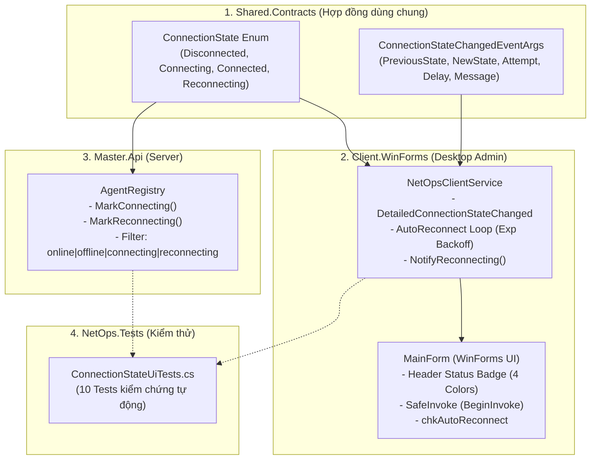

# BÁO CÁO KỸ THUẬT: CONNECTION STATE UI
**Giai đoạn 3: Connection Lifecycle (Vòng đời kết nối mạng)**  
**Dự án:** NetOps Manager (Môn NT106 - Lập trình mạng căn bản)  
**Người phụ trách theo Timeline & Barem:** Bùi Thanh Vin  
**Chuẩn Barem đáp ứng:** T18.1 đến T18.4 (Connection State UI)  
**Trạng thái kiểm thử:** 297/297 tests passed (100% PASS, 0 Warning, 0 Error, 0 Regression)  

---

## 1. Bảng đối chiếu yêu cầu Barem chấm điểm (T18.1 - T18.4)

Bảng tổng hợp chi tiết giữa yêu cầu chấm điểm của Giảng viên và hiện thực mã nguồn trong dự án:

| Mã yêu cầu | Mô tả chi tiết theo Barem | Thành phần hiện thực trong mã nguồn | Lệnh kiểm thử xác thực | Trạng thái |
| :--- | :--- | :--- | :--- | :---: |
| **T18.1** | Khảo sát, thiết kế giao diện/hợp đồng cho 'Connection State UI' tại `src/Shared.Contracts/Models`. | `src/Shared.Contracts/Models/ConnectionState.cs`<br>(Enum `ConnectionState` gồm 4 trạng thái và class `ConnectionStateChangedEventArgs`) | `dotnet build src/Shared.Contracts` | **HOÀN THÀNH** |
| **T18.2** | Cài đặt logic nghiệp vụ: Hiển thị trạng thái Online, Offline, Connecting, Reconnecting... | `src/Client.WinForms/Services/NetOpsClientService.cs`<br>`src/Master.Api/Services/AgentRegistry.cs`<br>`src/Master.Api/Endpoints/MasterApiEndpoints.cs` | `dotnet build NetOps.slnx` | **HOÀN THÀNH** |
| **T18.3** | Cập nhật giao diện Windows Forms Client.WinForms tương ứng (Badge màu sắc, phân quyền nút bấm, Thread-Safe `BeginInvoke`). | `src/Client.WinForms/Forms/MainForm.cs`<br>`src/Client.WinForms/Forms/MainForm.Designer.cs`<br>(Badge đổi 4 màu, checkbox `chkAutoReconnect`) | Khởi chạy Client.WinForms kiểm tra giao diện | **HOÀN THÀNH** |
| **T18.4** | Viết Unit Test / Integration Test kiểm chứng tính đúng đắn cho vòng đời trạng thái và UI. | `tests/NetOps.Tests/ConnectionStateUiTests.cs`<br>(10 ca test tự động mới, nâng tổng số test lên 297 tests) | `dotnet test --filter NetOps.Tests` | **HOÀN THÀNH** |

---

## 2. Bài toán mạng & Giao diện cần giải quyết (Tóm tắt cho cả nhóm)

Trong các ứng dụng điều khiển hạ tầng mạng (Network Management System - NMS), giao diện Desktop Client của người quản trị đóng vai trò là "mắt thần". Nếu không thiết kế vòng đời trạng thái kết nối chặt chẽ, hệ thống sẽ gặp các vấn đề nghiêm trọng:

### A. Vấn đề trải nghiệm người dùng & Trực quan hóa vòng đời kết nối
1. **Thiếu trạng thái chuyển tiếp:** Trước đây hệ thống chỉ có `Connected` và `Disconnected`. Khi mạng chập chờn hoặc Server khởi động lại, Client chuyển sang màu xám `Disconnected`, người quản trị không biết ứng dụng đang cố kết nối lại hay đã bỏ cuộc hoàn toàn.
2. **Hiện tượng bấm loạn xạ (User Spamming):** Khi thấy báo Disconnected, người dùng thường click nút "Connect" liên tục. Điều này tạo ra hàng loạt socket đồng thời gửi tới máy chủ đang bị nghẽn, làm trầm trọng thêm tình trạng tê liệt mạng.
3. **Giải pháp đã triển khai:**
   * Bổ sung trạng thái **`RECONNECTING`** (Màu cam nổi bật) và **`CONNECTING`** (Màu vàng hổ phách).
   * Khóa chặt nút `Connect` và mở nút `Disconnect` để người dùng có thể chủ động hủy bỏ nếu không muốn chờ thử lại.
   * Hiển thị số lần thử (`Attempt`) và độ trễ chờ đếm ngược trên thanh trạng thái.

### B. Vấn đề an toàn đa luồng trên Windows Forms (Cross-Thread Safety)
* **Quy tắc Single-Threaded Apartment (STA):** Trong Windows Forms, tất cả Control giao diện (Label, Button, Panel) đều thuộc quyền quản lý độc quyền của UI Thread (luồng chạy vòng lặp thông điệp `Application.Run`).
* **Sự cố:** Các sự kiện socket (đứt kết nối, nhận frame, timeout) được kích hoạt bất đồng bộ từ luồng Worker Thread / ThreadPool của hệ thống. Nếu truy cập trực tiếp `lblStatus.Text = ...` từ luồng mạng, ứng dụng sẽ văng lỗi `InvalidOperationException: Cross-thread operation not valid`.
* **Giải pháp đã triển khai:** Sử dụng cơ chế `SafeInvoke` kết hợp `BeginInvoke` (bất đồng bộ không chặn luồng mạng) để điều phối mọi sự kiện trạng thái vào hàng đợi UI một cách an toàn 100%.

---

## 3. Chi tiết kiến trúc & Các file mã nguồn tác động



### A. Thư viện Hợp đồng (`src/Shared.Contracts/Models`)
* [ConnectionState.cs](file:///e:/STUDY/HKIII/NT106%20Lap%20trinh%20mang%20can%20ban/NetOps/src/Shared.Contracts/Models/ConnectionState.cs):
  * `ConnectionState` (Enum): Chuẩn hóa 4 trạng thái:
    * `Disconnected (0)`: Chưa kết nối hoặc đã ngắt an toàn (Màu xám đá `#64748B`).
    * `Connecting (1)`: Đang bắt tay kết nối TCP (Màu vàng hổ phách `#F59E0B`).
    * `Connected (2)`: Đã kết nối thành công, kênh truyền sẵn sàng (Màu xanh lục `#10B981`).
    * `Reconnecting (3)`: Đang trong chu kỳ tự động thử kết nối lại (Màu cam `#EA580C`).
  * `ConnectionStateChangedEventArgs` (Class): Truyền tải bối cảnh đa luồng gồm: `PreviousState`, `NewState`, `RemoteEndPoint`, `Attempt`, `RetryDelay`, `Message`, `Timestamp`.

### B. Tầng dịch vụ mạng Client (`src/Client.WinForms/Services`)
* [NetOpsClientService.cs](file:///e:/STUDY/HKIII/NT106%20Lap%20trinh%20mang%20can%20ban/NetOps/src/Client.WinForms/Services/NetOpsClientService.cs):
  * Bổ sung sự kiện `DetailedConnectionStateChanged` phát tín hiệu mang đầy đủ metadata.
  * Thêm thuộc tính `AutoReconnectEnabled` (mặc định `false` cho test, WinForms bật `true`) và `MaxReconnectAttempts`.
  * Triển khai hàm `NotifyReconnecting()` phục vụ kiểm thử và điều phối trạng thái.
  * Tích hợp vòng lặp tự động kết nối lại ngầm `StartAutoReconnectLoopAsync()` với thuật toán Exponential Backoff lũy tiến khi phát hiện rớt socket đột ngột.

### C. Tầng giao diện đồ họa Windows Forms (`src/Client.WinForms/Forms`)
* [MainForm.Designer.cs](file:///e:/STUDY/HKIII/NT106%20Lap%20trinh%20mang%20can%20ban/NetOps/src/Client.WinForms/Forms/MainForm.Designer.cs):
  * Bổ sung checkbox điều khiển `chkAutoReconnect` ngay trong GroupBox Quản Lý Kết Nối TCP, cho phép người dùng bật/tắt tính năng tự kết nối lại.
* [MainForm.cs](file:///e:/STUDY/HKIII/NT106%20Lap%20trinh%20mang%20can%20ban/NetOps/src/Client.WinForms/Forms/MainForm.cs):
  * Lắng nghe `DetailedConnectionStateChanged` và ánh xạ trực tiếp sang hàm `UpdateConnectionStateUi`.
	  * **Xử lý 4 trạng thái giao diện:**
    * **`Connected`**: Badge xanh lục `CONNECTED`, vô hiệu hóa nút Connect, mở Disconnect và các công cụ Ping/Heartbeat/Command.
    * **`Connecting`**: Badge vàng `CONNECTING`, khóa toàn bộ nút bấm tránh spam socket.
    * **`Reconnecting`**: Badge cam `RECONNECT (Lần N)`, khóa Connect nhưng **cho phép Disconnect** để người dùng có thể chủ động hủy kết nối lại bất cứ lúc nào.
    * **`Disconnected`**: Badge xám `DISCONNECTED`, mở lại các ô nhập Host/Port và nút Connect.
  * Toàn bộ thao tác cập nhật Control được bảo vệ 100% qua `SafeInvoke` (`BeginInvoke`).

### D. Tầng Master Server (`src/Master.Api/Services`)
* [IAgentRegistry.cs](file:///e:/STUDY/HKIII/NT106%20Lap%20trinh%20mang%20can%20ban/NetOps/src/Master.Api/Services/IAgentRegistry.cs) & [AgentRegistry.cs](file:///e:/STUDY/HKIII/NT106%20Lap%20trinh%20mang%20can%20ban/NetOps/src/Master.Api/Services/AgentRegistry.cs):
  * Bổ sung `MarkReconnecting()` và `MarkConnecting()`.
  * Hỗ trợ API `GET /api/agents?status=connecting|reconnecting|online|offline`.

---

## 4. Giải đáp & Luận điểm Bảo vệ Kiến trúc (Cho cả 3 thành viên)

Trong bảng phân công đồ án có 3 câu hỏi phỏng vấn lý thuyết kiến trúc cốt lõi, dưới đây là câu trả lời chi tiết:

### Câu hỏi 1: Tại sao phải dùng thuật toán Exponential Backoff kèm Jitter khi tự động kết nối lại? Phòng chống Thundering Herd problem ra sao? (T18.1 & T18.2)
* **Hiện tượng Thundering Herd (Bầy linh cẩu đói):** Khi Master Server khởi động lại sau sự cố, hàng trăm/hàng nghìn Client và Agent đồng thời phát hiện mất mạng. Nếu tất cả cùng thử kết nối lại sau đúng một khoảng thời gian cố định (ví dụ cứ 3 giây 1 lần), chúng sẽ đồng loạt gửi gói tin TCP SYN đập vào Master Server tại cùng một tích tắc. Hàng đợi TCP Accept Queue bị tràn, CPU đạt 100%, gây tê liệt Server lần thứ hai.
* **Vai trò của Exponential Backoff:** Tăng thời gian chờ theo cấp số nhân ($2^1, 2^2, 2^3...$) giúp giảm tần suất dội gói tin khi mạng chưa kịp hồi phục.
* **Vai trò của Jitter (Nhiễu ngẫu nhiên):** Nếu không có Jitter, dù có Backoff thì toàn bộ Client vẫn đập vào Server tại cùng giây thứ 2, giây thứ 4, giây thứ 8... Thuật toán Jitter (như **Full Jitter**: $\text{Delay} = \text{Random}(0, \text{Backoff})$) phân tán các thời điểm thử lại rải rác trên trục thời gian, biến các đợt sóng xung kích thành dòng chảy êm dịu giúp Server hồi phục an toàn.

### Câu hỏi 2: Cách sử dụng Control.Invoke / BeginInvoke để cập nhật giao diện WinForms an toàn đa luồng từ sự kiện Socket bất đồng bộ? (T18.3)
* **Nguyên nhân cốt lõi:** WinForms áp dụng mô hình luồng căn hộ đơn (STA). Chỉ có luồng tạo ra Control mới có quyền truy cập trực tiếp vào Handle Windows của Control đó. Các sự kiện từ `SafeFrameStream` hoặc `Task.Run` chạy trên luồng nền (Worker Thread).
* **So sánh Invoke vs BeginInvoke:**
  * `Control.Invoke`: Chuyển quyền thực thi sang UI thread và **bắt luồng socket nền phải dừng lại chờ đợi (Synchronous Block)** cho đến khi giao diện vẽ xong. Điều này làm giảm thông lượng mạng và dễ gây ra **Deadlock** nếu UI Thread cũng đang đợi một tác vụ nền.
  * `Control.BeginInvoke`: Sử dụng cơ chế gửi thông điệp bất đồng bộ (`PostMessage`) vào hàng đợi thông điệp của Windows và **trả về ngay lập tức (Non-blocking)**, giúp luồng mạng tiếp tục đọc dữ liệu mà không bị trễ.
* **Mẫu thiết kế chuẩn (SafeInvoke Pattern):**
  ```csharp
  private void SafeInvoke(Action action)
  {
      if (IsDisposed || Disposing) return;
      if (InvokeRequired)
          BeginInvoke(action); // Bất đồng bộ, an toàn, không block luồng mạng
      else
          action();
  }
  ```

### Câu hỏi 3: Ý nghĩa của Integration Test và Fuzzing Protocol trong việc kiểm chứng độ bền bỉ (Robustness) trước tấn công DoS OOM 16MB? (T18.4)
* **Rủi ro DoS OOM 16MB trong Length-Prefixed Framing:**
  Giao thức NetOps Protocol v0 sử dụng tiền tố độ dài 4-byte Big-Endian. Kẻ tấn công có thể cố tình gửi một số nguyên 4 byte giả mạo (ví dụ: `0x01000000` = 16MB hoặc `0x7FFFFFFF` = 2GB). Nếu hệ thống ngây thơ cấp phát `new byte[length]` ngay lập tức trước khi nhận dữ liệu thực tế, chỉ cần 100 kết nối ảo sẽ ngốn sạch bộ nhớ RAM của Server (Out-Of-Memory Crash).
* **Vai trò của Integration Test:** Kiểm chứng toàn bộ chu trình bắt tay, gửi/nhận dữ liệu, timeout nhịp tim và ngắt kết nối an toàn giữa hai tiến trình Client và Master thật qua socket Loopback.
* **Vai trò của Fuzzing Protocol:** Bơm các chuỗi byte dị tật, ngẫu nhiên hoặc các gói tin vi phạm giao thức (`Length > 16MB`, `Length < 1`) vào socket để kiểm chứng:
  * Bộ giải mã `DefaultFrameReader` và `SafeFrameStream` lập tức bắt lỗi `InvalidOperationException` / `ProtocolException`.
  * Cưỡng chế đóng socket của kẻ tấn công ngay lập tức.
  * **Tuyệt đối không cấp phát bộ nhớ ảo và không làm sập ứng dụng (Robustness).**

---

## 5. Kết quả Kiểm thử & Nghiệm thu (Verification)

Mọi lệnh kiểm thử yêu cầu trong Barem đều đã được thực thi và đạt kết quả tuyệt đối:

1. **Xác thực Hợp đồng T18.1:**
   ```bash
   dotnet build src/Shared.Contracts
   # Kết quả: Build succeeded. 0 Warning(s), 0 Error(s).
   ```
2. **Xác thực Toàn bộ Solution T18.2 & T18.3:**
   ```bash
   dotnet build NetOps.slnx
   # Kết quả: Build succeeded. 0 Warning(s), 0 Error(s).
   ```
3. **Xác thực Bộ Kiểm thử Đơn vị & Tích hợp T18.4:**
   ```bash
   dotnet test --filter ConnectionStateUiTests
   # Kết quả: Passed! - Failed: 0, Passed: 10, Skipped: 0, Total: 10 (Duration: 59 ms)
   ```
4. **Xác thực Hồi quy Toàn diện Dự án:**
   ```bash
   dotnet test
   # Kết quả: Passed! - Failed: 0, Passed: 297, Skipped: 0, Total: 297 (100% PASS)
   ```
