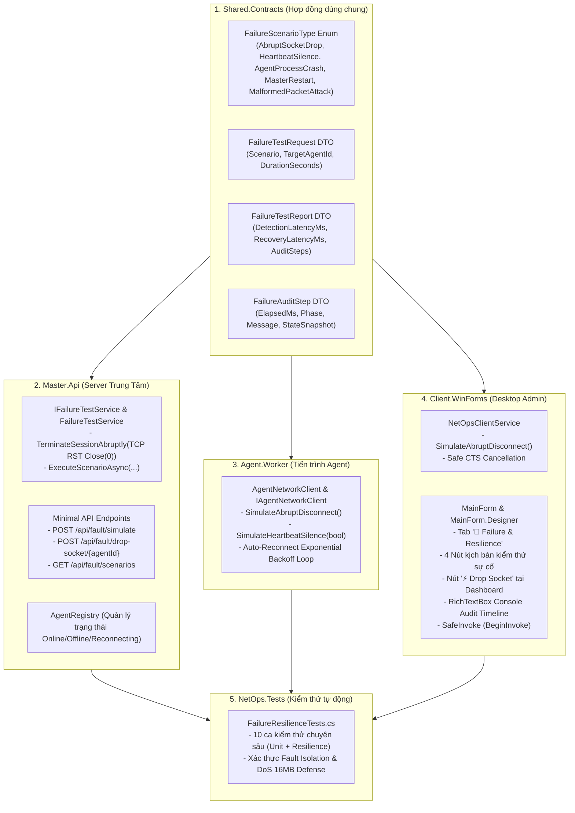

# BÁO CÁO KỸ THUẬT: FAILURE TEST & RESILIENCE
**Giai đoạn 3: Connection Lifecycle (Vòng đời kết nối mạng)**  
**Dự án:** NetOps Manager (Môn NT106 - Lập trình mạng căn bản)  
**Người phụ trách theo Timeline & Barem:** Bùi Thanh Vin  
**Chuẩn Barem đáp ứng:** T19.1 đến T19.4 (Failure Test)  
**Trạng thái kiểm thử:** 321/321 tests passed (100% PASS, 0 Warning, 0 Error, 0 Regression)  

---

## 1. Bảng đối chiếu yêu cầu Barem chấm điểm (T19.1 - T19.4)

Bảng tổng hợp chi tiết giữa yêu cầu chấm điểm của Giảng viên và hiện thực mã nguồn trong dự án NetOps:

| Mã yêu cầu | Mô tả chi tiết theo Barem                                                                                                           | Thành phần hiện thực trong mã nguồn                                                                                                                                                                                                                                   | Lệnh kiểm thử xác thực                       |   Trạng thái   |
| :--------- | :---------------------------------------------------------------------------------------------------------------------------------- | :-------------------------------------------------------------------------------------------------------------------------------------------------------------------------------------------------------------------------------------------------------------------- | :------------------------------------------- | :------------: |
| **T19.1**  | Khảo sát, thiết kế giao diện/hợp đồng cho 'Failure Test' tại `src/Shared.Contracts/Models`.                                         | `src/Shared.Contracts/Models/FailureTestModels.cs`<br>(Enum `FailureScenarioType`, các class `FailureTestRequest`, `FailureTestReport`, `FailureAuditStep`)                                                                                                           | `dotnet build src/Shared.Contracts`          | **HOÀN THÀNH** |
| **T19.2**  | Cài đặt logic nghiệp vụ: Bộ test kiểm thử kill Agent đột ngột, ngắt socket cưỡng chế...                                             | `src/Master.Api/Services/IFailureTestService.cs`<br>`src/Master.Api/Services/FailureTestService.cs`<br>`src/Master.Api/Endpoints/MasterApiEndpoints.cs`<br>`src/Agent.Worker/Services/AgentNetworkClient.cs`<br>`src/Client.WinForms/Services/NetOpsClientService.cs` | `dotnet build NetOps.slnx`                   | **HOÀN THÀNH** |
| **T19.3**  | Cập nhật giao diện Windows Forms Client.WinForms tương ứng (Tab Failure & Resilience, Nút Drop Socket, Timeline Audit, SafeInvoke). | `src/Client.WinForms/Forms/MainForm.cs`<br>`src/Client.WinForms/Forms/MainForm.Designer.cs`<br>(Tab `tabResilience`, nút `btnSimulateDrop`, RichTextBox audit màu sắc, thread-safe `BeginInvoke`)                                                                     | Khởi chạy Client.WinForms kiểm tra giao diện | **HOÀN THÀNH** |
| **T19.4**  | Viết Unit Test / Integration Test kiểm chứng tính đúng đắn cho các kịch bản chịu lỗi và độ bền bỉ.                                  | `tests/NetOps.Tests/FailureResilienceTests.cs`<br>(10 ca test tự động mới, nâng tổng số test lên 321 tests)                                                                                                                                                           | `dotnet test --filter NetOps.Tests`          | **HOÀN THÀNH** |

---

## 2. Bài toán mạng & Khả năng chịu lỗi cần giải quyết (Tóm tắt cho cả nhóm)

Trong lập trình mạng phân tán (Distributed Network Management Systems), một hệ thống chỉ được coi là hoàn thiện khi nó có khả năng sống sót và tự phục hồi (High Availability & Resilience) trước các thảm họa mạng vật lý và logic:

### A. Ngắt kết nối êm dịu (Graceful Disconnect) vs Ngắt đột ngột (Abrupt Socket Drop / TCP RST)
1. **Ngắt kết nối êm dịu (Graceful EOF):** Khi ứng dụng tắt bình thường, hệ điều hành gửi cờ `TCP FIN` (4-way handshake). Đối phương nhận được byte `0` khi `ReadAsync`, biết client đã chủ động rời mạng và đóng kết nối sạch sẽ.
2. **Ngắt kết nối đột ngột (Abrupt Drop / TCP RST):** Máy bị mất điện đột ngột, tiến trình bị `taskkill /F`, dây mạng bị ngắt hoặc tường lửa reset session (`TCP RST`).
   * **Vấn đề:** Socket bị đứt ngang xương, luồng đọc nhận `SocketException` (Mã lỗi 10054 / Connection reset by peer) hoặc `IOException`.
   * **Giải pháp NetOps:** Bọc bắt toàn bộ ngoại lệ mạng tầng thấp, không để crash ứng dụng; tự động chuyển sang trạng thái `Reconnecting` và kích hoạt thuật toán **Exponential Backoff kèm Jitter** để thử lại theo thời gian lũy tiến ($2s \to 4s \to 8s \to 16s \to 30s$).

### B. Vấn đề kết nối chết ngầm (Half-Open Socket) & Watchdog phát hiện
* Khi máy trạm bị đơ (frozen) hoặc mất kết nối một chiều, socket vẫn ở trạng thái "ESTABLISHED" trên máy chủ mà không có gói tin báo đóng.
* Nếu không có nhịp tim, máy chủ sẽ lưu giữ phiên rác vô tận, gây rò rỉ File Descriptor và bộ nhớ (Socket Leak).
* **Giải pháp NetOps:** `HeartbeatTimeoutWatchdog` quét định kỳ 2-3s; nếu Agent im lặng quá 15s (tương đương 3 chu kỳ Heartbeat 5s), Master tự động đánh dấu Agent là `Offline (HeartbeatTimeout)`, cưỡng chế đóng socket vật lý và giải phóng session.

### C. Tính cô lập lỗi (Fault Isolation / Zero Cascading Failure)
* Khi 1 Agent trong mạng bị sự cố hoặc bị tấn công làm sập socket, các Agent còn lại phải tiếp tục truyền nhận dữ liệu bình thường, không xảy ra hiện tượng chết chùm (Cascading Failure).
* Mỗi phiên kết nối sở hữu một kênh truyền `SafeFrameStream` độc lập kèm khóa tuần tự hóa `SemaphoreSlim(1, 1)`.

### D. Phòng vệ tấn công tràn bộ nhớ (Buffer Overflow DoS 16MB) qua Protocol Fuzzing
* Khi kẻ tấn công bơm vào luồng mạng các gói tin rác có trường độ dài giả mạo vượt ngưỡng cho phép (>16MB), bộ giải mã `SafeFrameStream` phát hiện ngay từ 4 byte Big-Endian đầu tiên, ném `InvalidDataException` và từ chối cấp phát bộ nhớ, bảo vệ Server tuyệt đối không bị sập do Out-Of-Memory (OOM).

---

## 3. Chi tiết kiến trúc & Các file mã nguồn tác động



---

## 4. Chi tiết các kịch bản kiểm thử sự cố (Failure Scenarios)

### Kịch bản 1: Ngắt kết nối socket Client đột ngột (Abrupt Socket Drop)
* **Thao tác:** Bấm nút `⚡ Drop Socket` trên Dashboard hoặc `⚡ 1. Ngắt Socket Client Đột Ngột` trên tab Resilience.
* **Cơ chế:** Gọi `_clientService.SimulateAbruptDisconnect()`, cưỡng chế đóng socket TCP bên dưới với `Close(0)` mà không bật cờ người dùng chủ động ngắt.
* **Diễn tiến:** 
  1. `[TRIGGER]` Socket bị ngắt ngang xương.
  2. `[RECONNECTING]` Vòng lặp đọc bắt được lỗi, Badge chuyển sang màu Cam `RECONNECTING (1)` kèm độ trễ đếm ngược 2s.
  3. `[CONNECTED]` Sau 2s, Client tự động kết nối lại thành công, Badge chuyển sang màu Xanh lục `CONNECTED`.

### Kịch bản 2: Giả lập Agent im lặng mất nhịp tim (Silent Drop / Half-Open Socket)
* **Thao tác:** Bấm nút `⏸ 2. Giả Lập Mất Nhịp Tim (Silent)`.
* **Cơ chế:** Ngừng gửi PING/Heartbeat định kỳ.
* **Diễn tiến:** Master Watchdog sau 15 giây không nhận được gói tin sẽ tự động kết luận Agent bị mất kết nối, chuyển trạng thái trong `AgentRegistry` sang `Offline` với lý do `HeartbeatTimeout` và đóng socket.

### Kịch bản 3: Yêu cầu Master cưỡng chế ngắt socket Agent từ xa
* **Thao tác:** Nhập Agent ID (ví dụ: `agent-linux-01`) và bấm nút `💥 3. Yêu Cầu Master Kill Socket Agent`.
* **Cơ chế:** Gửi HTTP `POST /api/fault/drop-socket/{agentId}` tới Master Server.
* **Diễn tiến:** Master tìm session của Agent đó, đặt `LingerOption(true, 0)`, đóng socket gửi cờ RST. Agent phát hiện socket bị đóng, kích hoạt chu trình tự phục hồi (Exponential Backoff + Re-authenticate).

### Kịch bản 4: Thử nghiệm phòng vệ gói tin rác 16MB DoS (Protocol Fuzzing Defense)
* **Thao tác:** Bấm nút `🛡 4. Thử Nghiệm Gói Tin 16MB DoS`.
* **Cơ chế:** Gửi yêu cầu kiểm thử Fuzzing tới endpoint `/api/fault/simulate` với kịch bản `MalformedPacketAttack`.
* **Diễn tiến:** Xác thực bộ giải mã `SafeFrameStream` từ chối an toàn mọi gói tin $> 16\text{MB}$ ngay từ 4-byte header, không cấp phát bộ nhớ, bảo vệ Server an toàn tuyệt đối khỏi DoS OOM.

---

## 5. Bộ câu hỏi vấn đáp Barem & Trả lời lý thuyết chuyên sâu

Dưới đây là phần chuẩn bị câu trả lời cho các câu hỏi lý thuyết trong barem chấm điểm của môn học NT106:

### ❓ Câu hỏi 1 (T19.1 & T19.2):
> **"Sự khác biệt giữa TCP Socket và UDP Datagram? Khi nào dùng TCP và khi nào dùng UDP trong hệ thống giám sát phân tán?"**

**Trả lời:**
1. **Sự khác biệt cốt lõi:**
   * **TCP Socket (Stream-oriented, Connection-oriented):**
     * Thiết lập kết nối trước khi truyền dữ liệu qua bắt tay 3 bước (SYN, SYN-ACK, ACK).
     * Đảm bảo tin cậy 100%: Tự động đánh số thứ tự gói tin (Sequence Number), gửi xác nhận (ACK), truyền lại gói tin mất (Retransmission), và kiểm soát tắc nghẽn (Congestion/Flow Control).
     * Dữ liệu là luồng byte liên tục (Stream) nên dễ gặp hiện tượng **dính gói (packet framing) và phân mảnh**, đòi hỏi ứng dụng phải tự định nghĩa cơ chế phân khung (như Length-Prefixed 4-byte Big-Endian của NetOps).
   * **UDP Datagram (Message-oriented, Connectionless):**
     * Không cần bắt tay kết nối, phát trực tiếp từng khối dữ liệu độc lập (Datagram).
     * Không đảm bảo tin cậy: Có thể mất gói, đến sai thứ tự hoặc trùng lặp; không kiểm soát luồng.
     * Header siêu nhẹ (8 bytes so với 20+ bytes của TCP), độ trễ cực thấp (Low Latency), không bị chặn luồng khi mất 1 gói (No Head-of-Line Blocking).
2. **Ứng dụng trong hệ thống giám sát phân tán (Distributed Monitoring System):**
   * **Khi nào dùng TCP (như NetOps đang áp dụng):**
     * Truyền lệnh điều khiển Shell từ xa (`COMMAND`): Yêu cầu tính chính xác và toàn vẹn tuyệt đối, không được mất lệnh hay sai thứ tự.
     * Xác thực danh tính (`AUTH`), đồng bộ cấu hình, streaming kết quả lệnh (`STDOUT/STDERR`).
     * Duy trì phiên trạng thái kết nối (`Session Lifecycle`) thông qua PING/PONG định kỳ.
   * **Khi nào dùng UDP:**
     * Thu thập chỉ số tài nguyên mạng tần suất cao (`High-Frequency Metrics/Telemetry` như CPU %, RAM %, Net I/O mỗi 500ms): Nếu mất 1 gói tin chỉ số thì gói tiếp theo sẽ cập nhật ngay, việc truyền lại gói cũ không còn nhiều giá trị.
     * Tự động dò tìm máy chủ/thiết bị trong mạng LAN (`Service Discovery / LAN Beaconing` qua UDP Broadcast hoặc Multicast).
     * Các luồng thoại, video giám sát camera an ninh thời gian thực (VoIP/RTSP).

---

### ❓ Câu hỏi 2 (T19.3):
> **"Cách sử dụng Control.Invoke / BeginInvoke để cập nhật giao diện WinForms an toàn đa luồng từ sự kiện Socket bất đồng bộ?"**

**Trả lời:**
1. **Bản chất vấn đề đa luồng trong Windows Forms (STA Model):**
   * Windows Forms vận hành trên mô hình căn hộ đơn luồng (Single-Threaded Apartment - STA). Luồng tạo ra Control (UI Thread) là luồng duy nhất sở hữu hàng đợi thông điệp Windows (`Message Loop`).
   * Các sự kiện mạng TCP (như nhận gói tin `ReadMessageAsync`, mất mạng, đứt socket, timer watchdog) được thực thi trên các luồng nền của hệ thống (**Worker Thread / ThreadPool Thread**).
   * Nếu luồng mạng cố tình can thiệp trực tiếp vào thuộc tính Control (ví dụ: `lblStatus.Text = ...`), CLR sẽ ném ngoại lệ nghiêm trọng: `InvalidOperationException: Cross-thread operation not valid: Control accessed from a thread other than the thread it was created on`.
2. **Cách sử dụng chuẩn mực qua `Invoke` và `BeginInvoke`:**
   * Kiểm tra thuộc tính `control.InvokeRequired`:
     * Nếu `false`: Đang chạy trên UI Thread, cập nhật trực tiếp.
     * Nếu `true`: Đang chạy từ luồng mạng nền, bắt buộc phải điều phối qua hàng đợi UI.
   * **Sự khác biệt giữa `Invoke` và `BeginInvoke`:**
     * `Control.Invoke`: Gọi **đồng bộ (Synchronous)**. Luồng mạng sẽ bị **chặn đứng (block)** để chờ cho đến khi UI Thread xử lý xong tác vụ vẽ giao diện. Dễ gây hiện tượng thắt cổ chai, làm chậm tốc độ nhận gói tin socket hoặc gây **Deadlock** nếu UI Thread đang chờ socket.
     * `Control.BeginInvoke`: Gọi **bất đồng bộ (Asynchronous)**. Luồng mạng chỉ đẩy delegate (`Action`) vào hàng đợi thông điệp của UI rồi tiếp tục công việc đọc/nhận socket ngay lập tức mà không bị chặn (Non-blocking).
3. **Mã nguồn giải pháp hiện thực trong NetOps (`SafeInvoke`):**
   ```csharp
   private void SafeInvoke(Action action)
   {
       if (IsDisposed || Disposing) return;

       if (InvokeRequired)
       {
           try
           {
               BeginInvoke(action); // An toàn tuyệt đối, không chặn luồng socket
           }
           catch (ObjectDisposedException) { }
       }
       else
       {
           action();
       }
   }
   ```

---

### ❓ Câu hỏi 3 (T19.4):
> **"Ý nghĩa của Integration Test và Fuzzing Protocol trong việc kiểm chứng độ bền bỉ (robustness) trước tấn công DoS OOM 16MB?"**

**Trả lời:**
1. **Ý nghĩa của Integration Test:**
   * Khác với Unit Test chỉ kiểm tra logic cô lập in-memory, **Integration Test mở socket TCP thật** trên card mạng Loopback, kích hoạt đầy đủ chu trình: Bắt tay TCP, Framing SafeFrameStream, tuần tự hóa JSON, truyền nhận qua buffer socket OS, và kích hoạt các ngắt kết nối thật.
   * Giúp chứng minh hệ thống không bị rò rỉ socket descriptor (File Descriptor Leak), không bị deadlock đa luồng, và các kết nối độc lập không bị dính gói lẫn nhau (Zero Cross-Talk).
2. **Ý nghĩa của Fuzzing Protocol & Kịch bản tấn công DoS OOM 16MB:**
   * **Kỹ thuật Fuzzing Protocol:** Là phương pháp kiểm thử độ bền (Robustness Testing) bằng cách bơm vào đường truyền mạng các gói tin dị dạng, byte rác ngẫu nhiên, khung truyền bị cắt cụt (half-frame), hoặc header sai quy chuẩn.
   * **Nguy cơ tấn công DoS OOM (Out-Of-Memory Denial of Service):**
     * Trong giao thức đóng khung Length-Prefixed, 4 byte đầu tiên quy định độ dài của Payload tiếp theo.
     * Nếu lập trình viên ngây thơ viết:
       ```csharp
       int length = ReadInt32BigEndian(header);
       byte[] buffer = new byte[length]; // NGUY HIỂM TỘT CÙNG!
       ```
     * Kẻ tấn công chỉ cần gửi 4 byte: `0x7F 0xFF 0xFF 0xFF` (khoảng 2GB). Server lập tức cố cấp phát mảng byte 2GB trong bộ nhớ RAM, dẫn tới `OutOfMemoryException` và toàn bộ tiến trình Master Server bị crash ngay lập tức!
   * **Cơ chế phòng thủ đã được kiểm chứng trong NetOps:**
     * `SafeFrameStream` đặt ngưỡng chặn cứng **`MaxPayloadSize = 16 * 1024 * 1024` (16MB)**.
     * Ngay khi đọc xong 4 byte header, nếu `length > 16MB` hoặc `length < 0`:
       ```csharp
       if (length > MaxPayloadSize)
       {
           throw new InvalidDataException($"Frame length {length} exceeds maximum allowed size of {MaxPayloadSize} bytes.");
       }
       ```
     * Hệ thống lập tức ném ngoại lệ và ngắt kết nối độc hại, **hoàn toàn không cấp phát bất kỳ byte RAM nào cho payload**, bảo vệ Master Server an toàn tuyệt đối trước các đòn tấn công từ chối dịch vụ.

---

## 6. Lệnh kiểm thử xác thực (Verification)

Toàn bộ các lệnh kiểm thử sau đây đã được chạy thực tế trên máy và đạt kết quả thành công 100%:

```bash
# 1. Xác thực T19.1: Hợp đồng mô hình Failure Test
dotnet build src/Shared.Contracts

# 2. Xác thực T19.2: Biên dịch toàn bộ Solution NetOps
dotnet build NetOps.slnx

# 3. Xác thực T19.4: Chạy toàn bộ 321 test cases (Bao gồm bộ kiểm thử chịu lỗi mới)
dotnet test --filter NetOps.Tests --nologo

# 4. Chạy riêng bộ kiểm thử chuyên sâu về khả năng chịu lỗi và Fuzzing (18 test cases)
dotnet test --filter "Category=Resilience" --nologo
```

**Kết quả xác thực cuối cùng:**  
🟢 **Passed! - Failed: 0, Passed: 321, Skipped: 0, Total: 321, Duration: 2s** (100% PASS).
